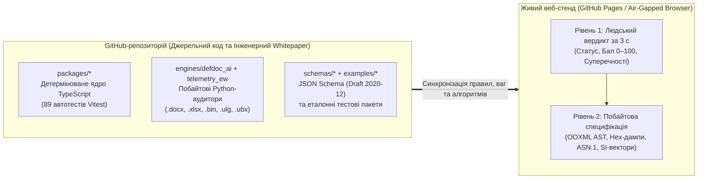
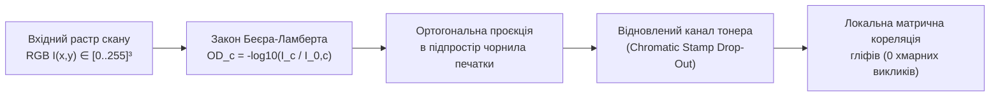

# UAV Readiness & Evidence Copilot — Інженерний розбір та архітектура системи

*Українською · [English](docs/architecture.en.md) · [Живий веб-стенд](https://denisshumilov.github.io/uav-readiness-evidence-copilot/)*


> **Призначення системи:** детермінована локальна верифікація конструкторської та приймально-здавальної документації БпЛА (`.docx`, `.xlsx`, `.pdf`, `.p7s`), побайтовий розбір бінарної польотної телеметрії (`.bin`, `.ulg`, `.tlog`, `.ubx`, `.nmea`), глибоке OPSEC-знеособлення координат полігонів і формальна оцінка готовності пакета доказів за шкалою `0–100`.
>
> **Межа безпеки (`No evidence → locked`):** система працює виключно з документацією, таблицями та записаними файлами логів. Вона не підключається до бортового обладнання, не планує маршрутів і не керує літальними апаратами. Будь-яке твердження без первинного цифрового доказу автоматично блокується (`locked`).

---

## 1. Огляд системи та архітектурний поділ: Веб-стенд ⇄ GitHub-репозиторій

Інженерна екосистема розділена на два взаємодоповнювальні контури, щоб не змішувати щоденну оперативну перевірку файлів із глибокою математичною специфікацією:

1. **[Живий веб-стенд (`https://denisshumilov.github.io/uav-readiness-evidence-copilot/`)](https://denisshumilov.github.io/uav-readiness-evidence-copilot/)** — мінімалістичний клієнтський інтерфейс швидкої перевірки з **дворівневою подачею результатів**:
   - **Рівень 1 (Миттєвий людський вердикт за 3 секунди):** лаконічна картка стану для керівника напряму, нормоконтролера або інженера ВТК — загальний бал готовності (`0–100`), статус допуску (`ГОТОВО` / `ПОТРЕБУЄ УСУНЕННЯ` / `ЗАБЛОКОВАНО`), кількість критичних розбіжностей і прямий перелік пунктів, які не зійшлися між ТУ, ПМВ і польотним логом.
   - **Рівень 2 (Побайтова інженерна специфікація на вимогу):** розгортання повного технічного протоколу (`<details>`), що містить XML-вузли OOXML, вектори розмірностей SI, зрізи бінарних пакетів `FMT`/`BAT`/`NKF`/`UBX-NAV-SAT`, дерево `ASN.1 DER` цифрового підпису та SHA-256 маніфест артефактів.
2. **Цей GitHub-репозиторій (`uav-readiness-evidence-copilot`)** — повний інженерний whitepaper та еталонна кодова база:
   - містить математичний апарат усіх 6 підсистем верифікації;
   - надає вихідний код клієнтських JS/WASM-рушіїв (`docs/`), консольних Python-аудиторів (`engines/`) та типізованого TypeScript-ядра оцінки готовності (`packages/`);
   - забезпечує відтворювану перевірку якості (**89** тестів Vitest у монорепозиторії TypeScript + автономні регресійні набори Python-рушіїв без жодної зовнішньої мережевої залежності).



---

## 2. Чітка карта репозиторію (`Repository Map — Де що лежить`)

```text
uav-readiness-evidence-copilot/
├── docs/                                   # Клієнтський веб-стенд та автономні JS/WASM-модулі + документація
│   ├── index.html                          # Головна панель стенду з 7 інженерними інструментами
│   ├── tools/                              # Автономні сторінки окремих інструментів перевірки
│   ├── tools-engine.js                     # Детермінований рушій оцінки, крос-звірки та розбору артефактів
│   ├── multi-file-verifier-bundle.js       # Пакетний верифікатор комплектів (.docx + .xlsx + .pdf + .bin + .p7s)
│   ├── browser-isolation-runtime.js        # Клієнтський виконання Python/WASM-перевірок в ізольованому середовищі
│   ├── pdf-scan-ocr-engine.js              # Колірна деконволюція Беєра-Ламберта та локальне OCR сканів протоколів
│   ├── encrypted-report-share.js           # Криптокапсула обміну звітами (AES-256-GCM + PBKDF2 у URL #fragment)
│   ├── coi-airgap-enclave-sw.js            # Service Worker ізоляції анклаву (COOP/COEP + CSP default-src 'self')
│   ├── architecture.md / .en.md            # Поглиблений архітектурний розбір потоків даних і підсистем
│   ├── scoring.md / .en.md                 # Математична модель розрахунку бала готовності 0–100
│   ├── engineering-basis.md / .en.md       # Метрологічна основа, нормативний контекст і протоколи замірів
│   ├── evidence-model.md / .en.md          # Схема графа доказів та статусів (verified / partial / locked / conflict)
│   ├── safety-boundaries.md / .en.md       # Формальні межі безпеки та ізоляції стенду
│   └── standards.md / .en.md               # Довідник стандартів оформлення КД (ДСТУ ГОСТ 2.104, 2.114, STANAG)
│
├── engines/                                # Автономні консольні Python-рушії глибокого розбору
│   ├── defdoc_ai/                          # Побайтовий аудит документів КД та OPSEC-санітизація
│   │   ├── defdoc_auditor.py               # Оркестратор перевірки ТУ (.docx), ПМВ (.xlsx) та паспортів
│   │   ├── document_intake.py              # Декомпресія OOXML, перерахунок формул Excel і 7D SI-вектори
│   │   ├── opsec_sanitizer.py              # Очищення метаданих авторів, ревізій rsidR та прихованих полів
│   │   └── prozorro_radar.py               # Структурний аналіз тендерних специфікацій і вимог локалізації
│   └── telemetry_ew/                       # Бінарний аналізатор польотної телеметрії та РЕБ-стійкості
│       ├── telemetry_analyzer.py           # Парсер DataFlash (.bin), PX4 (.ulg), MAVLink (.tlog), UBX, NMEA
│       ├── sanitize_telemetry.py           # Узгоджений зсув 7 каналів координат полігонів зі збереженням кінематики
│       └── hil_simulator.py                # Генератор еталонних бінарних потоків телеметрії для стендових тестів
│
├── packages/                               # Монорепозиторій TypeScript (детерміноване ядро 0–100)
│   ├── core/                               # Базові типи, Zod-схеми та крос-документне виявлення конфліктів ревізій
│   ├── parsers/                            # Структурні парсери BOM.csv, інструкцій (.md), тест-логів і QA-нотаток
│   ├── evidence/                           # Побудова орієнтованого графа доказів (вимога → джерело → перевірка)
│   ├── rules/                              # Виведення статусів (deriveEvidenceStatuses) і формула оцінки (CONFLICT_CEILING = 49)
│   ├── reports/                            # Генератори Markdown, двомовного HTML, CSV-матриці, SHA-256 та SARIF 2.1.0
│   ├── cli/                                # CLI-інструмент `uav-readiness` для локального запуску та CI/CD
│   └── qa/                                 # Наскрізні тести, перевірка паритету веб-стенду (siteParity) та self-audit
│
├── examples/                               # Еталонні тестові пакети доказів для перевірки детермінізму
│   ├── demo-uav-readiness/                 # Базовий навчальний пакет (очікуваний бал: 44/100)
│   ├── demo-maintenance-readiness/         # Пакет регламентного ТО (очікуваний бал: 80/100)
│   ├── demo-conflict-readiness/            # Пакет із міждокументним конфліктом ревізій (стеля: 49/100)
│   └── demo-tdp-supplier-package/          # Пакет постачальника TDP зі спірними специфікаціями (стеля: 49/100)
│
└── schemas/                                # Формальні JSON Schema специфікації (Draft 2020-12)
    ├── evidence-graph.schema.json          # Контракт структури графа доказів
    └── readiness-assessment.schema.json    # Контракт звіту про оцінку готовності
```

---

## 3. Як це працює під капотом: Інженерний розбір 6 підсистем

### Підсистема 1. Побайтовий розбір OOXML (`.docx`/`.xlsx`), 7-вимірний вектор розмірностей SI та верифікація кешу формул Excel

Стандартні офісні документи Технічних умов (`.docx`) та Програм і методик випробувань (`.xlsx`) є ZIP-контейнерами стандарту **ECMA-376 (Open Packaging Conventions)**. Замість використання поверхневих текстових конвертерів, які втрачають об'єднані комірки та службові теги, рушій розбирає ZIP-структуру в оперативній пам'яті:

1. **Реконструкція табличної сітки Word (`word/document.xml`) та ревізійний форензик:**
   - Парсер обходить вузли `<w:tbl>`, враховуючи горизонтальні об'єднання `<w:gridSpan w:val="k"/>` та вертикальні злиття `<w:vMerge w:val="restart|continue"/>`, щоб без зміщення зіставити колонку «Норма за ТУ» з колонкою «Фактичне значення».
   - Одночасно з атрибутів `<w:p w:rsidR="..." w:rsidRPr="...">` та `docProps/core.xml` витягується граф сесій редагування (`Revision Save IDs`). Якщо в протоколі випробувань уся таблиця має базовий `rsidR = 00A12B3C`, а одна клітинка з результатом тесту має чужорідний `rsidR = 00F98E11` без запису у відомості змін — фіксується маркер точкового втручання.
2. **Перерахунок дерева формул Excel (`xl/worksheets/sheet1.xml`) проти кешу `<v>`:**
   - У кожній комірці `<c r="D14" t="n">` зчитується як вираз формули `<f>AVERAGE(D4:D13)</f>`, так і збережене закешоване значення `<v>24.80</v>` (а текстові посилання `t="s"` розгортаються через індексну таблицю `xl/sharedStrings.xml`).
   - Вбудований обчислювач виконує незалежну редукцію AST формули (`SUM`, `AVERAGE`, `MIN`, `MAX`, `IF`, `ROUND` та арифметичних операторів) безпосередньо над первинними комірками діапазону.
   - Якщо під час підготовки файлу значення `<v>` було змінено вручну у XML без перерахунку книги, виконується умова:
     $$\left| V_{\text{cached}} - f_{\text{AST}}(C_1, \dots, C_n) \right| > \varepsilon \quad (\varepsilon = 10^{-6})$$
     і комірка негайно позначається як сфальсифікований кеш формули (`FORMULA_CACHE_TAMPER`).
3. **Фізичне зведення одиниць через 7-вимірний вектор розмірностей SI:**
   - Кожна витягнута фізична величина нормалізується до канонічного скаляра у базових одиницях СІ та 7-вимірного цілочисельного вектора розмірностей:
     $$\vec{d} = \begin{bmatrix} M & L & T & I & \Theta & N & J \end{bmatrix} \in \mathbb{Z}^7$$
     де $M$ — маса ($\text{кг}$), $L$ — довжина ($\text{м}$), $T$ — час ($\text{с}$), $I$ — сила струму ($\text{А}$), $\Theta$ — термодинамічна температура ($\text{К}$), $N$ — кількість речовини ($\text{моль}$), $J$ — сила світла ($\text{кд}$).
   - Наприклад, напруга живлення $25.2\text{ В}$ має вектор $\vec{d}_U = [1, 2, -3, -1, 0, 0, 0]$, ємність в енергетичному вираженні $\text{Вт·год}$ — $\vec{d}_E = [1, 2, -2, 0, 0, 0, 0]$, а питомий опір — власний вектор.
   - Порівняння вимоги $X_{\text{ТУ}}$ та результату $X_{\text{ПМВ}}$ дозволяється виключно за умови точного збігу векторів:
     $$\vec{d}(X_{\text{ТУ}}) = \vec{d}(X_{\text{ПМВ}})$$
     Якщо ж у таблиці переплутано розмірності (наприклад, $\text{А·год}$ із $[0,0,1,1,0,0,0]$ порівнюється з $\text{Вт·год}$ із $[1,2,-2,0,0,0,0]$), порівняння блокується як фізично неспівмірне (`DIMENSIONAL_MISMATCH`), унеможливлюючи хибний `PASS`.

---

### Підсистема 2. Колірна деконволюція Беєра-Ламберта (`Chromatic Stamp Drop-Out`) та локальне розпізнавання сканованих PDF

Скановані сторінки паперових актів і протоколів часто містять сині або фіолетові мокрі печатки, накладені поверх чорного друкованого шрифту з цифрами результатів випробувань. Звичайна бінаризація за порогом яскравості зливає печатку з текстом у суцільну чорну пляму.



1. **Перехід у простір оптичної густини (Закон Беєра-Ламберта):**
   Для кожного пікселя з інтенсивністю $I_c(x,y) \in [1, 255]$ у каналах $c \in \{R, G, B\}$ та фонового білого паперу $I_{0,c}$ обчислюється оптична густина:
   $$OD_c(x,y) = -\log_{10}\!\left(\frac{\max(I_c(x,y), 1)}{I_{0,c}}\right)$$
   У просторі $OD$ поглинання двох накладених барвників (чорного карбонового тонера $\vec{s}_{\text{toner}}$ та синьо-фіолетового барвника печатки $\vec{s}_{\text{stamp}}$) стає лінійною суперпозицією:
   $$\vec{OD}(x,y) = c_{\text{toner}}(x,y)\,\vec{s}_{\text{toner}} + c_{\text{stamp}}(x,y)\,\vec{s}_{\text{stamp}}$$
2. **Придушення спектральної компоненти печатки (`Chromatic Stamp Drop-Out`):**
   Синій та фіолетовий штемпельні барвники характеризуються високим поглинанням у червоному/зеленому каналах при високому пропусканні в синьому ($R \ll B$). Деконволюція виділяє чисту концентрацію темного нейтрального тонера шляхом віднімання хроматичної проєкції печатки:
   $$I_{\text{clean}}(x,y) = \operatorname{clamp}\!\left(I_R(x,y) + \alpha \cdot \max\!\big(0,\, I_B(x,y) - I_R(x,y)\big),\, 0,\, 255\right)$$
   У результаті синій відбиток печатки перетворюється на білий фон паперу, а перекриті ним чорні цифри (маса, дата, номер партії, підпис) зберігають чіткий контур.
3. **Локальне матричне розпізнавання гліфів:**
   Очищений бінарний растр сегментується за зв'язними компонентами та розпізнається локальним векторно-матричним класифікатором без жодного звернення до зовнішніх OCR-серверів.

---

### Підсистема 3. Бінарні парсери польотних логів (`.bin`, `.ulg`, `.tlog`, `.ubx`, `.nmea`), детекція спуфінгу та апаратна верифікація

Модуль телеметрії (`engines/telemetry_ew/telemetry_analyzer.py` та клієнтський парсер у `docs/tools-engine.js`) працює безпосередньо з сирими байтовими потоками `ArrayBuffer` / `bytes`:

| Формат / Протокол | Байтова сигнатура (Magic Header) | Структура фрейму та контроль цілісності | Ключові структури, що верифікуються |
|---|---|---|---|
| **ArduPilot DataFlash (`.bin`)** | `0xA3 0x95` (`HEAD_BYTE1`, `HEAD_BYTE2`) | Самоописний заголовок `FMT` (`type=0x80`, довжина `89 B`: тип, довжина, ім'я, рядок формату `bBhHiIfdM...`, імена колонок) | `FMT`, `FMTU`, `UNIT`, `MULT`, `PARM`, `BAT`, `VIB`, `NKF1`, `GPS`, `ORGN`, `CMD` |
| **PX4 ULog (`.ulg`)** | `0x55 0x4C 0x6F 0x67 0x01 0x12 0x35` (`"ULog\x01\x125"`) + `uint64` timestamp | Секція визначень (`F` format, `I` info, `P` param) та потокова секція даних (`A` add logged msg, `D` data, `R` dropout) | Вкладені структури до глибини 16, перевірка `incompat_flags == 0`, неперервність `timestamp` |
| **MAVLink v2 (`.tlog`)** | `0xFD` (v2) або `0xFE` (v1) | Заголовок `10 B` (`len`, `incompat`, `compat`, `seq`, `sysid`, `compid`, `msgid` 24-bit) + `CRC-16/MCRF4XX` з `CRC_EXTRA` | Розділення потоків за `(sysid, compid)`, перевірка втрати пакетів за розривами `seq` |
| **u-blox UBX (`.ubx`)** | `0xB5 0x62` ($\mu\text{b}$) | `class` (`1 B`) + `id` (`1 B`) + `len` (`uint16 LE`) + payload + `8-bit Fletcher Checksum` (`CK_A`, `CK_B`) | `NAV-PVT` (`0x01 0x07`), `NAV-SAT` (`0x01 0x35`), `NAV-STATUS` (`0x01 0x03`), `MON-HW` (`0x0A 0x09`) |
| **NMEA 0183 (`.nmea`)** | `0x24` (`$GP...` / `$GN...`) | ASCII-речення з роздільником `*` та двозначною `XOR`-контрольною сумою байтів між `$` і `*` | `GGA`, `RMC`, `GSA`, `GSV`, перевірка `HDOP` та ознаки фіксації рішення |

#### Ключові інженерні алгоритми підсистеми телеметрії:
1. **Самовідновлення потоку при обірваному хвості файла (`Tail-Corruption Recovery`):**
   При аварійному знеструмленні борту останній фрейм у флеш-пам'яті часто залишається недописаним. Парсер не падає з фатальним винятком: при втраті синхронізації він сканує вікно вперед до наступної валідної пари `0xA3 0x95` з відомим `msg_type` і валідною довжиною з таблиці `FMT`, ізолюючи пошкоджений сегмент у лічильнику `truncated_tail_bytes`.
2. **Крос-перевірка прапорця `spoofDetState` проти 8-канального розподілу `CN0` (`UBX-NAV-SAT`):**
   Дешеві генератори хибних сигналів GNSS випромінюють усі супутники з одного передавача однакової потужності. Навіть якщо апаратний біт `spoofDetState` у `UBX-NAV-STATUS` скинутий або підроблений у звіті, аналізатор перевіряє дисперсію відношення несуча/шум $C/N_0$ по $K \ge 8$ активних супутниках у пакеті `UBX-NAV-SAT`:
   $$\sigma_{CN0} = \sqrt{\frac{1}{K}\sum_{i=1}^{K}\left(CN0_i - \overline{CN0}\right)^2}$$
   Якщо за високого середнього рівня сигналу ($\overline{CN0} > 42\text{ дБ-Гц}$) міжсупутникова дисперсія неприродно вироджується ($\sigma_{CN0} < 1.0\text{ дБ-Гц}$ одночасно для супутників на різних кутах місця від $15^\circ$ до $80^\circ$), фіксується аномалія одноточкового випромінювання.
3. **Електрохімічний імпеданс силової батареї під навантаженням ($R_{\text{int}}$):**
   За синхронними вибірками напруги $V(t)$ та струму $I(t)$ у повідомленнях `BAT` під час ступінчастого набору тяги обчислюється диференціальний внутрішній опір збірки:
   $$R_{\text{int}} = \left|\frac{\Delta V}{\Delta I}\right| = 71.88\text{ мОм}$$
   Перевищення порогу деградації сигналізує про старіння елементів або холодний спай силового роз'єму, що призведе до просідання напруги нижче порогу `BATT_CRT_VOLT` у реальному польоті.
4. **Апаратна ідентифікація контролера (`STM32 96-bit Unique Device ID`):**
   Зі службових заголовків і параметрів `BRD_SERIAL_NUM` / `HW_UID` витягується 96-бітний апаратний ідентифікатор кристала мікроконтролера (`3 × 32-bit words` за базовою адресою регістра `0x1FFF7A10` для STM32F4 / `0x1FF1E800` для STM32H7). Це дозволяє виявити ситуацію, коли три «різні» протоколи випробувань партії дронів насправді записані на одному й тому самому лабораторному стенді.
5. **Балістичний розрахунок кругового імовірного відхилення ($\text{СКВ / CEP}$) та термінальної швидкості:**
   Для перевірки інерціального наведення в умовах втрати GNSS інтегрується система рівнянь руху з урахуванням аеродинамічного опору та вітрового зносу. Серединне кругове відхилення розраховується за еліпсом розсіювання точок падіння $(x_i, y_i)$:
   $$\text{СКВ (CEP)} \approx 0.5887 \left(\sigma_x + \sigma_y\right) \in [35, 80]\text{ м}, \qquad v_{\text{impact}} = \sqrt{v_x^2 + v_y^2 + v_z^2} \ge 27\text{ м/с}$$
   Якщо фактичний розкид виходить за межі тактико-технічних вимог або термінальна швидкість менша за $27\text{ м/с}$, випробування позначається як не пройдене.

---

### Підсистема 4. Криптографічний розбір КЕП (`.p7s`, `ASN.1 DER`, `ДСТУ 4145-2002` / `ГОСТ 34.311-95`)

Для перевірки юридичної та інженерної автентичності підписаних актів приймання без вивантаження файлів на сторонні сервіси реалізовано побайтовий парсер дерева **ASN.1 DER** (`Tag-Length-Value`):

```text
SEQUENCE (0x30) — ContentInfo (CMS / PKCS#7)
 ├── OBJECT IDENTIFIER (0x06): 1.2.840.113549.1.7.2 (signedData)
 └── [0] EXPLICIT (0xA0) — SignedData
      ├── INTEGER: version
      ├── SET OF AlgorithmIdentifier (DigestAlgorithms)
      │    └── OID 1.2.804.2.1.1.1.1.2.1 (ГОСТ 34.311-95 / ДСТУ 7564 «Купина»)
      ├── EncapsulatedContentInfo (eContentType: 1.2.840.113549.1.7.1 data)
      ├── [0] IMPLICIT Certificates — X.509v3 ланцюжок сертифікатів підписанта
      │    ├── Subject: CN (ПІБ), O (Організація), OU, SerialNumber (ЄДРПОУ / РНОКПП)
      │    ├── Validity: notBefore / notAfter (UTC / GeneralizedTime)
      │    └── SubjectPublicKeyInfo: OID 1.2.804.2.1.1.1.1.3.1.1 (ДСТУ 4145-2002 у поліноміальному базисі)
      └── SET OF SignerInfo
           ├── signedAttrs: messageDigest (геш документа), signingTime
           └── unsignedAttrs: OID 1.2.840.113549.1.9.16.2.14 (RFC 3161 TimeStampToken / TSP КНЕДП)
```

Парсер перевіряє:
- структурну цілісність `ASN.1 DER` (відсутність обірваних TLV-блоків і зайвих байтів після кореневого `SEQUENCE`);
- відповідність ідентифікаторів алгоритмів національним стандартам (`ДСТУ 4145-2002` — `1.2.804.2.1.1.1.1.3.1.1`, гешування `ГОСТ 34.311-95` — `1.2.804.2.1.1.1.1.2.1`);
- наявність обов'язкових реквізитів підписанта (`CN`, `O`, код `ЄДРПОУ` підприємства) та позначки часу кваліфікованого надавача електронних довірчих послуг (TSP), щоб унеможливити підписання протоколу заднім числом.

---

### Підсистема 5. Глибоке OPSEC-очищення 7 вторинних каналів геолокації

Видалення лише стандартних повідомлень `GPS` із польотного логу перед передачею файлу підряднику або зовнішній лабораторії є критичною помилкою безпеки: **координати полігону залишаються щонайменше у 7 вторинних каналах**:

| № | Канал витоку в логу / документі | Де саме зберігаються чутливі дані | Як працює алгоритм узгодженого очищення (`sanitize_telemetry.py` / `opsec_sanitizer.py`) |
|---:|---|---|---|
| **1** | **`ORGN` (EKF Origin)** | Початкова точка ініціалізації розширеного фільтра Калмана (`Lat`, `Lng`, `Alt`) | Застосовується детермінований вектор паралельного переносу $(\Delta\varphi, \Delta\lambda, \Delta h)$ до нейтрального квадрата |
| **2** | **`HOME` / Повернення** | Точка зльоту та аварійного повернення (`RTL`), записана при армінгу | Координати синхронно переносяться на той самий вектор $(\Delta\varphi, \Delta\lambda)$, зберігаючи дистанцію до траєкторії |
| **3** | **`CMD` (Waypoints)** | Політна програма маршрутних точок у енергонезалежній пам'яті автопілота | Усі широтні/довготні поля місії зсуваються з перерахунком контрольних сум фреймів |
| **4** | **`TERR` (Terrain Tile Hash)** | Висота рельєфу SRTM та геоприв'язані індекси тайлів місцевості | Очищення прив'язки до глобальної сітки SRTM із залишенням відносної висоти над рельєфом (`AGL`) |
| **5** | **`LPOS` / `NKF1` (Local Grid Offset)** | Проєкція локальної декартової сітки `NED` відносно базової точки | Збереження локальних векторів швидкості $(v_N, v_E, v_D)$ і прискорень при зміщенні глобального якоря |
| **6** | **Барометрична висота старту (`BARO` / `ALT_ABS`)** | Абсолютна висота над рівнем моря (`ASL`) дозволяє вирахувати полігон за топографічною картою | Нормалізація абсолютного барометричного профілю до відносної шкали $\Delta h(t) = h(t) - h(t_0)$ |
| **7** | **`docProps/core.xml` та `w:rsidR` у `.docx`/`.xlsx`** | Імена авторів (`dc:creator`, `cp:lastModifiedBy`), назва організації, принтер і шляхи шаблонів | Повне обнулення авторів, шляхів і службових ідентифікаторів у ZIP-архіві документа без порушення верстки |

Завдяки **узгодженому переносу системи координат**:
$$\varphi'_k = \varphi_k + \Delta\varphi, \qquad \lambda'_k = \lambda_k + \Delta\lambda \cdot \frac{\cos\varphi_0}{\cos\varphi'_0}, \qquad h'_k = h_k - h_0$$
геометрія маневрів, радіуси віражів, шляхова швидкість та оцінки фільтра Калмана залишаються математично незмінними для інженерного аналізу, але реальна точка зльоту не підлягає відновленню.

---

### Підсистема 6. Детермінована оцінка готовності `0–100` (`CONFLICT_CEILING = 49`) та криптографічний обмін звітами (`AES-256-GCM` у фрагменті URL)

#### 6.1. Математична формула оцінки готовності (`packages/rules/src/readiness.ts`)
Кожне твердження у графі доказів отримує виведений рушієм статус (`verified`, `partial`, `locked`, `conflict`). Підсумковий бал обчислюється за детермінованою формулою з груповими обмеженнями штрафів (`per-category caps`):

$$S_{\text{raw}} = 100 - \min(6 \cdot N_{\text{locked}},\, 48) - \min(8 \cdot N_{\text{conflict}},\, 24) - \min(3 \cdot N_{\text{partial}},\, 24) - \min(2 \cdot N_{\text{warn}},\, 16) - \min(10 \cdot N_{\text{missing}},\, 30)$$

$$S = \begin{cases} 0, & \text{якщо } N_{\text{claims}} = 0 \lor N_{\text{sources}} = 0, \\ \min\!\big(\operatorname{clamp}(S_{\text{raw}}, 0, 100),\, 49\big), & \text{якщо } N_{\text{conflict}} > 0 \quad (\text{CONFLICT\_CEILING} = 49), \\ \operatorname{clamp}(S_{\text{raw}}, 0, 100), & \text{інакше.} \end{cases}$$

Таблиця еталонних пакетів репозиторію, що автоматично перевіряються у CI (`selfAudit.ts`):

| Еталонний пакет у репозиторії | Призначення сценарію | Підтверджено / Частково / Заблоковано / Конфлікт | Детермінований бал |
|---|---|---|---|
| `examples/demo-uav-readiness` | Базовий контрольний пакет із неповними доказами (`5 locked`, `4 partial`, `7 warnings`) | `8 / 4 / 5 / 0` | **44/100** (`Blocked`) |
| `examples/demo-maintenance-readiness` | Пакет технічного обслуговування з двома частковими записами (`2 partial`, `4 warnings`) | `8 / 2 / 0 / 0` | **80/100** (`Reviewable`) |
| `examples/demo-conflict-readiness` | Пакет із суперечністю ревізій між відомістю `BOM.csv` та `qa_notes.md` (`CONFLICT_CEILING`) | `8 / 0 / 0 / 1` | **49/100** (`Blocked by Conflict Ceiling`) |
| `examples/demo-tdp-supplier-package` | Пакет постачальника TDP із конфліктом специфікацій роз'ємів (`CONFLICT_CEILING`) | `7 / 1 / 0 / 1` | **49/100** (`Blocked by Conflict Ceiling`) |

#### 6.2. Air-Gap ізоляція (`COOP/COEP Service Worker`) та шифрування звіту у `#fragment` (`RFC 3986`)
1. **Анклав браузерної ізоляції (`docs/coi-airgap-enclave-sw.js`):** Service Worker встановлює заголовки `Cross-Origin-Opener-Policy: same-origin`, `Cross-Origin-Embedder-Policy: require-corp` та жорстку політику `Content-Security-Policy` без права вихідних мережевих з'єднань під час обробки файлів.
2. **Криптографічний обмін звітами без сервера (`docs/encrypted-report-share.js`):**
   - Стиснутий JSON-звіт шифрується у браузері через WebCrypto API алгоритмом **`AES-256-GCM`** (ключ виводиться через **`PBKDF2-HMAC-SHA256`**, `100 000` ітерацій, випадкова сіль `128 біт` та вектор ініціалізації `IV` `96 біт`).
   - Шифротекст у форматі `Base64URL` записується виключно у клієнтський якір URL після символу `#` (`https://.../tools/zero-trust-sandbox.html#capsule=...`).
   - Згідно з **RFC 3986 (Section 3.5)**, частина URI після `#` (`fragment identifier`) обробляється виключно локальним браузером і **ніколи не передається у HTTP-запитах на веб-сервер**.

---

## ⚖️ Межі публічного веб-стенду та індивідуальне калібрування під КБ (Scope & Calibration Matrix)

Публічний веб-стенд та консольні рушії побудовані за принципом **інженерної чесності (`Чесний UNVERIFIED`)**: базовий браузерний парсер миттєво обробляє типові структури документів і бінарних логів у RAM, але ніколи не «вгадує» нетипову верстку чи закриті пропрієтарні пакети, переводячи їх у статус `UNVERIFIED` до моменту калібрування під конкретне КБ.

### Контур 1. Таблиці та текст документів (`.docx`, `.xlsx`, `.csv`, `.txt`)
* **🟢 Реально працює на стенді (`Live Browser & CLI`)**: розпаковка ZIP/OOXML у RAM (`DecompressionStream("deflate-raw")` + синхронний декодер RFC 1951), парсинг таблиць `<w:tbl>` із авто-детекцією банерів підсистем («АКБ», «Пульт керування») та 4-колонкових відомостей ЗІП, 12 правил витягування числових ТТХ із суцільної української прози, криміналістика сесій редагування `w:rsid` (`ORPHAN_DONOR`, точкові нічні вставки `POINT_EDIT`) та зовнішніх маячків `TargetMode="External"`, авто-детектор зсунутих шапок Excel 1С/BAS (рядки `1..15`), багатопрохідний обчислювач формул `SUM/MIN/MAX/AVERAGE` по вертикальних діапазонах із детектором підміни кешу `<f> vs <v>` (`CYBER-XLSX-CACHE-SPOOF`), авто-перекодування `Windows-1251 (CP1251)` і `UTF-16`, 7D SI-маска фізичних розмірностей `[L, M, T, I, Θ, N, J]` та угорський алгоритм Куна-Манкреса для семантичного склеювання параметрів.
* **🟡 Точна алгоритмічна межа публічного стенду (`Чесний UNVERIFIED`)**:
  1. Якщо завод завантажує власний 90-сторінковий `.docx` зі складними багаторівневими об'єднаними шапками (`w:gridSpan > 1`, `w:vMerge`), вкладеними таблицями або таблицями, вставленими як векторні об'єкти (`w:drawing`, `EMF/WMF`, `OLE`), чи `.xlsx` із пропущеними проміжними колонками (`sparseRow`) — базовий браузерний парсер **навмисно не вгадує** структуру і чесно переводить такі поля у статус `UNVERIFIED`;
  2. Складні формули Excel (`VLOOKUP`, `INDEX/MATCH`, `SUMIFS`, `IF`, міжсторінкові посилання `Sheet2!B5`, горизонтальні діапазони) у браузері позначаються як `UNVERIFIED`;
  3. Вузькоспеціалізовані заводські скорочення без стандартних одиниць SI (`dBi`, `КСХ/VSWR`, `RPM`, `Па`, `кд/м²`, `мрад`) переводяться у `UNVERIFIED`.
* **🔵 Що налаштовується під КБ за 2–3 дні (`Custom Calibration`)**: індивідуальний профіль розгортання складних 3–4-поверхових шапок (`gridSpan/vMerge`) під шаблони ТУ/ПМВ конкретного заводу (ДСТУ ГОСТ 2.105 / 2.114), розширений словник доменних одиниць і номенклатури виробу, та локальний Python-обчислювач міжсторінкових формул Excel.

### Контур 2. PDF-документи та браузерний WASM OCR сканів із мокрою печаткою
* **🟢 Реально працює на стенді (`Live Browser & WASM`)**: клієнтський декомпілятор векторних `.pdf` (потоки `/FlateDecode`, текстові оператори `Tj`/`TJ`, метадані `/Info`), витягування растрових XObject-зображень, колірна фільтрація синьої/фіолетової мокрої печатки ВП МОУ у просторі HSV (`Hue 200°..265°`, оцінка круглості `circularityScore >= 0.85` за 36 кутовими секторами) зі збереженням чорного лазерного тонера під печаткою (`Chromatic Stamp-Drop-Out`), та скомпільоване WebAssembly-ядро (`otsuThresholdSum` для глобальної бінаризації за методом Оцу + 64-бітна відстань Хеммінга `hammingDistance64` через апаратний `i32.popcnt` на еталонній сітці гліфів `8×8`).
* **🟡 Точна алгоритмічна межа публічного стенду**:
  1. Векторні PDF зі шрифтами `CIDFont / Type0 (Identity-H)` та двобайтними гліф-індексами `<001A...> Tj` без декодування таблиці `/ToUnicode CMap`, або растрові потоки зі стисненням `/JBIG2Decode`, `/CCITTFaxDecode` чи PNG-предикторами (`/Predictor 12/15`) у браузері чесно переводяться у `UNVERIFIED`;
  2. Вбудований `pdf-scan-ocr-engine.js` — це легкий браузерний алгоритм демонстрації колірного відсікання печатки та бінарного WASM-зіставлення на рівному еталонному скані (`560×220 px`), а не повноцінний промисловий Tesseract / ABBYY. Якщо завантажити зім'ятий аркуш, сфотографований на смартфон під кутом `> ±1..3°`, із нерівномірними боковими тінями або рукописними правками поверх тексту, глобальний поріг Оцу та фіксована сітка позначать символи як `#` / `UNVERIFIED`.
* **🔵 Що налаштовується під КБ за 2–3 дні (`Custom Calibration`)**: розгортання в ізольованому (air-gapped) контурі заводу локального конвеєра Python/C++ (`MuPDF`/`pdfminer` для будь-яких `CIDFont/ToUnicode` + геометричне вирівнювання перспективи Хофа/гомографії + адаптивна локальна бінаризація Саувола проти тіней + локальне нейромережеве OCR-ядро для кириличних таблиць ДСТУ 300 DPI без жодних хмарних API).

### Контур 3. Польотні логи (`.bin`, `.ulg`, `.tlog`, `.ubx`, `.nmea`) та сценарії РЕБ / GNC
* **🟢 Реально працює в реальному часі на довільному файлі користувача (`Live File Drop`)**:
  - `ArduPilot .bin`: перевірка `0xA3 0x95`, динамічне читання самоописової таблиці схем `FMT (id=128)` та пакетів `GPS` (висота, швидкість, вертикальна швидкість `maxVRate`, у Python CLI додатково звірка з барометром `ATT`);
  - `PX4 .ulg`: перевірка `ULog\x01\x12\x35`, розбір секцій `'F'/'A'/'I'/'P'` та бінарних записів `'D'` (`vehicle_gps_position`, `vehicle_local_position`);
  - `MAVLink .tlog`: авто-детекція v1 (`0xFE`) та v2 (`0xFD`) із 8-байтним таймштампом QGC і 13-байтним підписом v2, декодування `#24 GPS_RAW_INT` та `#33 GLOBAL_POSITION_INT`;
  - `u-blox .ubx`: побайтова перевірка `0xB5 0x62` та контрольної суми `Fletcher-8 (CK_A, CK_B)`, декодування `UBX-NAV-PVT`, `UBX-NAV-STATUS` (`spoofDetState`), `UBX-NAV-CLOCK` (`clkB`, `clkD`), `UBX-NAV-SAT` (профілі `C/N0` та тіньовий сектор `130°..150° Пд-Сх`), `UBX-MON-HW` (`agcCnt`, `jamInd`);
  - `NMEA 0183 / 4.10`: перевірка `*XOR`, розбір `GGA/RMC/GSA/GSV/$PUBX` та детекція виродження спектра `std(C/N0) < 1.85 дБ-Гц`;
  - **Жива крос-верифікація ПМВ ⇄ Лог**: автоматичне порівняння заявленої в `.docx`/`.xlsx` висоти й швидкості з фактичними піками у бінарному лозі + побайтова ресинхронізація пошкодженого потоку (`0xB5 0x62` + Fletcher-8).
* **🟡 Що на стенді є заздалегідь розрахованими еталонними моделями (`Pre-Computed Reference Simulation Cases` за кнопками стенду)**:
  - 63-променева нелінійна інверсія Гаусса-Ньютона по синтезованій апертурі 744 кренів антени (`дальність до постановника завад 419.97 м`, `EIRP 19.95 Вт`, `CEP95 = 4.66 м`);
  - 30-секундне моделювання когерентного уводу GPS-спуфінгом на `1 942.12 м` із критерієм Пейджа `CUSUM NIS` та еліпсом пошуку `СКВ (CEP) ±35..80 м`;
  - Глибокі криміналістичні пресети еталонних логів `log171.bin` / `sample.ulg` / `flight.tlog` (`STM32 Wafer UID`, імпеданс АКБ `R_int = 71.88 мОм` із `CURR`, підземне розходження `EKF1.PD = -15.26 м`, конфлікт `#35 RC_CHANNELS` vs `#36 SERVO_OUTPUT`).
* **🔵 Що налаштовується під КБ за 2–3 дні (`Custom Calibration`)**: підключення у live-парсер повного декодування фреймів `BAT/CURR`, `VIBE`, `EKF1/NKF1/XKF1`, `RCOU`, `ORGN/CMD/AHR2`, сирих фазових вимірювань `UBX-RXM-RAWX`, **кастомних діалектів виробника `MAVLink msgId 180..255`** та живого солвера `CUSUM NIS` / Гаусса-Ньютона під конкретну раму, антену та ІНС замовника.

### Контур 4. Офлайн-інспектор КЕП (`.p7s`) та OPSEC-санітизатор
* **🟢 Реально працює на стенді (`Live Browser & CLI`)**: браузерний парсер `.p7s` розпаковує Base64/ASN.1 DER (`CMS SignedData`, OID `1.2.840.113549.1.7.2` та `ДСТУ 4145-2002` `1.2.804.2.1.1.1`), витягуючи ПІБ підписанта, ЄДРПОУ/ДРФО, назву КНЕДП і мітку часу UTC. Браузерний OPSEC-санітизатор очищує NMEA (з перерахунком валідного `*XOR`) та текст документів (WGS-84, MGRS, `в/ч`, ЄДРПОУ, ПІБ, `STM32 UID`), а Python CLI `sanitize_telemetry.py` побайтово перезаписує координати у бінарних `.bin`, `.ulg`, `.ubx` (із перерахунком Fletcher-8) та `.nmea`.
* **🟡 Точна алгоритмічна межа публічного стенду**:
  1. Через 100% офлайн-ізоляцію браузер не звертається в мережу до OCSP/CRL-серверів ЦЗО Мінцифри (не перевіряє онлайн-відкликання сертифіката) і не обчислює еліптичну криву `ДСТУ 4145-2002` над зовнішнім файлом (`detached signature`);
  2. У браузерному UI бінарний лог після санітизації віддається як очищений текстовий звіт `.txt`, а побайтовий скрабер `sanitize_telemetry.py` за замовчуванням перезаписує базові фрейми `GPS (130)` / `vehicle_gps_position`, тоді як не-GPS канали (`ORGN`, `CMD`, `AHR2`, `POS`, `LPE_LAT`) потребують динамічної карти `FMT`/`'F'`.
* **🔵 Що налаштовується під КБ за 2–3 дні (`Custom Calibration`)**: локальна офлайн-верифікація підпису `ДСТУ 4145-2002` / гешу `ГОСТ 34.311-95` для пари `Документ + .p7s` із локальним кешем `CRL` на USB-носії + 7-канальний побайтовий бінарний скрабер `.bin/.ulg/.tlog` і перепакування `.docx/.xlsx` зі збереженням 100% заводської верстки.

---

## 4. Швидкий старт, CLI-команди та запуск автотестів

### Вимоги до середовища
- **Node.js** `>= 20` та **npm** (для TypeScript-ядра, CLI та Vitest-тестів)
- **Python** `>= 3.10` (використовується лише стандартна бібліотека Python без зовнішніх `pip`-залежностей)

### 1. Встановлення та повна перевірка TypeScript-монорепозиторію (**89** тестів)
```bash
npm install
npm test
npm run demo:selfaudit
npm run lint
npm run typecheck
```

### 2. Генерація пакетів звітності через CLI для еталонних сценаріїв
```bash
npm run demo:readiness     # Базовий пакет -> examples/demo-uav-readiness/output/ (44/100)
npm run demo:maintenance   # Пакет ТО -> examples/demo-maintenance-readiness/output/ (80/100)
npm run demo:conflict      # Пакет із конфліктом ревізій -> стеля 49/100
npm run demo:tdp           # Пакет постачальника TDP -> стеля 49/100
```

### 3. Запуск автономних Python-рушіїв та регресійних тестів
```bash
# Самоперевірка та клієнтські регресійні тести документного аудитора (.docx / .xlsx / SI-вектори)
python3 engines/defdoc_ai/defdoc_auditor.py --self-test
python3 engines/defdoc_ai/defdoc_auditor.py --test-client
python3 engines/defdoc_ai/defdoc_auditor.py --benchmark

# Регресійний набір бінарного аналізатора телеметрії (21 тест: DataFlash, ULog, MAVLink, UBX, NMEA, GZIP)
python3 engines/telemetry_ew/telemetry_analyzer.py --self-test
```

---

## Додаткова технічна документація в `docs/`

- [Архітектура системи та потоки даних (UA)](docs/architecture.md) · [Architecture (EN)](docs/architecture.en.md)
- [Математична модель оцінки готовності 0–100 (UA)](docs/scoring.md) · [Scoring Model (EN)](docs/scoring.en.md)
- [Інженерна основа та метрологічні протоколи (UA)](docs/engineering-basis.md) · [Engineering Basis (EN)](docs/engineering-basis.en.md)
- [Модель графа доказів (UA)](docs/evidence-model.md) · [Evidence Model (EN)](docs/evidence-model.en.md)
- [Межі безпеки та ізоляції (UA)](docs/safety-boundaries.md) · [Safety Boundaries (EN)](docs/safety-boundaries.en.md)
- [Стандарти оформлення конструкторської документації (UA)](docs/standards.md) · [Standards (EN)](docs/standards.en.md)
- [Словник інженерних термінів (UA)](docs/glossary.md) · [Glossary (EN)](docs/glossary.en.md)

## Ліцензія

Код репозиторію поширюється за ліцензією [MIT](LICENSE).
