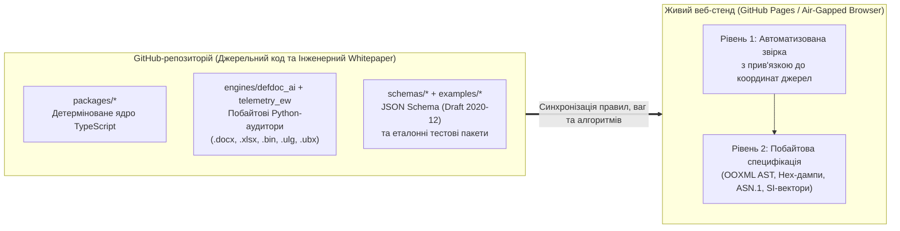

# UAV Readiness & Evidence Copilot (`v2.5.0`) — Інженерний розбір та архітектура системи

*Українською · [English](README.en.md) · [Живий веб-стенд](https://denisshumilov.github.io/uav-readiness-evidence-copilot/)*


> **Автоматизую перевірку комплектів технічної документації під процеси вашої компанії.**
> Розробляю локальні інструменти для звірки технічних документів і таблиць. Вони знаходять розбіжності, показують джерела висновків та окремо позначають те, що не вдалося перевірити. Починаємо з одного вашого процесу й узгодженого набору файлів.

> **Призначення системи (`v2.5.0`):** детермінована локальна верифікація конструкторської та приймально-здавальної документації БпЛА (`.docx`, `.xlsx`, `.pdf`, `.p7s`), побайтовий розбір бінарної польотної телеметрії (`.bin`, `.ulg`, `.tlog`, `.ubx`, `.nmea`), глибоке OPSEC-знеособлення координат полігонів і формальна оцінка повноти та узгодженості пакета доказів за шкалою `0–100`.
>
> **Межа безпеки (`No evidence → locked / UNVERIFIED`, резервний fallback-режим):** система працює виключно з документацією, таблицями та записаними файлами логів. Вона не підключається до бортового обладнання, не планує маршрутів і не керує літальними апаратами. Відсутність доказів (`locked` або `0/100` за нульового пакета) означає **«НЕДОСТАТНЬО ДАНИХ / UNVERIFIED (НЕ ОЦІНЕНО) — оцінюється повнота і узгодженість наданого пакета доказів, а не льотна придатність борту»**.

---

## 1. Огляд системи та архітектурний поділ: Веб-стенд ⇄ GitHub-репозиторій

Інженерна екосистема розділена на два взаємодоповнювальні контури, щоб не змішувати щоденну оперативну перевірку файлів із глибокою математичною специфікацією:

1. **[Живий веб-стенд (`https://denisshumilov.github.io/uav-readiness-evidence-copilot/`)](https://denisshumilov.github.io/uav-readiness-evidence-copilot/)** — мінімалістичний клієнтський інтерфейс швидкої перевірки з **дворівневою подачею результатів**:
   - **Рівень 1 (Автоматизована локальна звірка за лічені секунди з прив'язкою до точних координат джерел):** лаконічна картка стану для керівника напряму, нормоконтролера або інженера ВТК — загальний бал повноти доказів (`0–100`), статус перевірки (`ГОТОВО` / `ПОТРЕБУЄ УСУНЕННЯ` / `ЗАБЛОКОВАНО` / `UNVERIFIED`), кількість критичних розбіжностей і прямий перелік пунктів, які не зійшлися між ТУ, ПМВ і польотним логом.
   - **Рівень 2 (Побайтова інженерна специфікація на вимогу):** розгортання повного технічного протоколу (`<details>`), що містить XML-вузли OOXML, вектори розмірностей SI, зрізи бінарних пакетів `FMT`/`BAT`/`NKF`/`UBX-NAV-SAT`, дерево `ASN.1 DER` цифрового підпису та SHA-256 маніфест артефактів.
2. **Цей GitHub-репозиторій (`uav-readiness-evidence-copilot`, реліз `v2.5.0`)** — повний інженерний whitepaper та еталонна кодова база:
   - містить математичний апарат усіх 6 підсистем верифікації;
   - надає вихідний код клієнтських JS/WASM-рушіїв (`docs/`), консольних Python-аудиторів (`engines/`) та типізованого TypeScript-ядра оцінки готовності (`packages/`);
   - забезпечує відтворювану перевірку якості (**133** тестів Vitest у монорепозиторії TypeScript + автономні регресійні набори Python-рушіїв без жодної зовнішньої мережевої залежності).



---

## 2. Чітка карта репозиторію (`Repository Map — Де що лежить`)

```text
uav-readiness-evidence-copilot/
├── docs/                                   # Клієнтський веб-стенд та автономні JS/WASM-модулі + документація
│   ├── index.html                          # Головна панель стенду (8 interactive local browser tools)
│   ├── tools/                              # Автономні сторінки 8 спеціалізованих інструментів (зокрема universal-ai-cockpit.html)
│   ├── tools-engine.js                     # Детермінований рушій оцінки, крос-звірки та розбору артефактів
│   ├── multi-file-verifier-bundle.js       # Пакетний верифікатор комплектів (.docx + .xlsx + .pdf + .bin + .p7s)
│   ├── browser-isolation-runtime.js        # Діагностика браузерної origin-ізоляції та capability probes
│   ├── pdf-scan-ocr-engine.js              # HSV/RGB-фільтрація мокрої печатки (Chromatic Stamp Drop-Out) та локальне OCR сканів (148-B WASM)
│   ├── encrypted-report-share.js           # Криптокапсула обміну звітами (AES-256-GCM + PBKDF2 у URL #diag=)
│   ├── coi-airgap-enclave-sw.js            # Service Worker браузерної origin-ізоляції (COOP/COEP + CSP default-src 'self')
│   ├── architecture.md / .en.md            # Поглиблений архітектурний розбір потоків даних і підсистем
│   ├── scoring.md / .en.md                 # Математична модель розрахунку бала готовності 0–100
│   ├── engineering-basis.md / .en.md       # Метрологічна основа, нормативний контекст і протоколи замірів
│   ├── evidence-model.md / .en.md          # Схема графа доказів та статусів (verified / partial / locked / conflict)
│   ├── safety-boundaries.md / .en.md       # Формальні межі безпеки та ізоляції стенду
│   └── standards.md / .en.md               # Довідник стандартів оформлення КД (ДСТУ ГОСТ 2.104:2006, 2.114-97, STANAG)
│
├── engines/                                # Автономні консольні Python-рушії глибокого розбору
│   ├── defdoc_ai/                          # Побайтовий аудит документів КД та OPSEC-санітизація
│   │   ├── defdoc_auditor.py               # Оркестратор перевірки ТУ (.docx), ПМВ (.xlsx) та паспортів (v2.5.0)
│   │   ├── document_intake.py              # Декомпресія OOXML, перерахунок формул Excel і словникова SI-нормалізація (UNITS)
│   │   ├── sanitize_doc.py                 # Токенізація PII/чутливих сутностей у .docx, .xlsx, .md (v2.5.0)
│   │   └── test_client_intake.py           # Набір із 24 регресійних тестів клієнтського парсингу та безпеки
│   └── telemetry_ew/                       # Бінарний аналізатор польотної телеметрії
│       ├── telemetry_analyzer.py           # Парсер DataFlash (.bin), PX4 (.ulg), MAVLink (.tlog), UBX, NMEA
│       ├── sanitize_telemetry.py           # Зсув координат полігонів у бінарних та текстових логах
│       └── test_readiness.py               # Набір із 23 регресійних тестів бінарних парсерів телеметрії (вкл. ReferenceControllerVectorsTest)
│
├── packages/                               # Монорепозиторій TypeScript (детерміноване ядро 0–100, v2.5.0)
│   ├── core/                               # Базові типи, Zod-схеми та крос-документне виявлення конфліктів ревізій
│   ├── parsers/                            # Структурні парсери BOM.csv, інструкцій (.md), тест-логів, QA-нотаток та дизамбігуація ID
│   ├── evidence/                           # Побудова орієнтованого графа доказів (вимога → джерело → перевірка)
│   ├── rules/                              # Виведення статусів (deriveEvidenceStatuses) і формула оцінки (CONFLICT_CEILING = 49)
│   ├── reports/                            # Генератори Markdown, двомовного HTML, CSV-матриці, SHA-256 та SARIF 2.1.0
│   ├── cli/                                # CLI-інструмент `uav-readiness` для локального запуску та CI/CD
│   └── qa/                                 # Наскрізні тести, перевірка JSON Schema (Ajv), Playwright E2E та self-audit
│
├── examples/                               # Еталонні тестові пакети доказів для перевірки детермінізму
│   ├── demo-uav-readiness/                 # Базовий навчальний пакет (очікуваний бал: 44/100)
│   ├── demo-maintenance-readiness/         # Пакет регламентного ТО (очікуваний бал: 80/100)
│   ├── demo-conflict-readiness/            # Пакет із міждокументним конфліктом ревізій (стеля: 49/100)
│   └── demo-tdp-supplier-package/          # Пакет постачальника TDP зі спірними специфікаціями (стеля: 49/100)
│
└── schemas/                                # Формальні JSON Schema специфікації (Draft 2020-12)
    ├── evidence-graph.schema.json          # Контракт структури графа доказів
    └── readiness-assessment.schema.json    # Контракт звіту про оцінку готовності
```

---

## 3. Триконтурна Матриця Можливостей (`Browser Local UI` vs `Python CLI Engines` vs `TypeScript Core & CLI`)

| Контур | Формати та структура входу | Що реально перевіряється | Який вихід формується | Чесні обмеження | Чим підтверджено (тест / команда) |
|---|---|---|---|---|---|
| **1. Browser Local UI (`docs/*.js`, `docs/index.html`, `universal-ai-cockpit.html`)** | `.docx`, `.xlsx`, `.csv`, `.tsv`, `.pdf` (растровий еталонний шаблон `560×220 px` + векторний `/FlateDecode`), `.p7s` (`ASN.1 DER`), `.bin`, `.ulg`, `.tlog`, `.ubx`, `.nmea`, `.c/.cpp/.py/.lua` | Міждокументні колізії ТТХ (7D SI-вектори), кеш формул Excel (`SUM`, `AVERAGE`, `MIN`, `MAX`, `COUNT` та `+`, `-`, `*`, `/`), відсікання мокрої печатки та гліф-класифікація фіксованого шаблону `560×220 px`, структурна цілісність `CMS SignedData` (`.p7s`) за RFC 5652 та `SignerInfo.sid`, заголовки та CRC бінарних логів, дублікати за `SHA-256` | Чотиристовпцева таблиця «Спочатку проблеми» (`Параметр \| Результат / статус \| Джерела \| Наступна дія`), криптокапсула `#diag=` (`AES-256-GCM` + 128-бітний CSPRNG ключ), експорт Markdown/CSV/JSON | У браузері НЕ виконується математична перевірка підпису `ДСТУ 4145-2002` та запити OCSP/CRL (`UNVERIFIED_CRYPTO`); браузерний OCR працює лише для фіксованого шаблону `560×220 px` (довільні скани → `UNVERIFIED`); 1 документ без пари отримує `SINGLE_SOURCE_UNVERIFIED` | `npm test` (`siteParity.test.ts`, `browserIntegration.test.ts`, `browserE2E.test.ts` на Playwright Chromium) |
| **2. Python CLI Engines (`engines/defdoc_ai/*`, `engines/telemetry_ew/*`)** | `.docx`, `.xlsx`, `.md`, `.txt` + бінарні логи `.bin`, `.ulg`, `.tlog`, `.ubx`, `.nmea`, `.csv`, `.gz` (до `64 MiB`, ZIP-ліміт `128 MiB`) | Таблиці `<w:tbl>` із `gridSpan`/`vMerge`, інтервали, допуски `±`, комплектність BOM, крос-звірка ПМВ проти бінарного логу польоту, контрольні суми `Fletcher-8` / `CRC-16/MCRF4XX` / `XOR`, OPSEC-токенізація PII (`leaked_pii_tokens_remaining = 0`) | Markdown-звіт аудиту (`.audit.md`), очищені `.sanitized.docx/.xlsx`, JSON-статистика деідентифікації та телеметрії, 4-файловий бандл для TypeScript-ядра | Не розпізнає суперечності у вільному прозовому тексті без таблиць і нестандартні колонки без одиниць SI чи операторів норми (`UNVERIFIED`); не робить причинних висновків про РЕБ | `python3 engines/defdoc_ai/defdoc_auditor.py --self-test`, `--test-client`, `--benchmark`, `sanitize_doc.py --json-stats`, `telemetry_analyzer.py --self-test` |
| **3. TypeScript Core & CLI (`packages/core`, `parsers`, `rules`, `evidence`, `reports`, `cli`)** | Строгий 4-файловий контракт пакета доказів: `BOM.csv`, `demo_manual.md`, `test_log.csv`, `qa_notes.md` (демо та реальні BYOD-папки без банера `SYNTHETIC DEMO`) | Прив'язка кожного твердження до непорожнього артефакту й цитати, виявлення висячих посилань (`dangling_evidence`), статус тестів (`fail`/`blocked` → `locked`), конфлікти ревізій `subject=value` (`CONFLICT_CEILING = 49`), `Zero-Evidence Ceiling = 0` | `readiness-assessment.json`, `evidence-graph.json`, `readiness-report.md`, `traceability-matrix.csv` (із захистом від CSV-ін'єкцій), `artifact-hashes.json`, `readiness.sarif` (`SARIF 2.1.0`) | Оцінює виключно повноту і узгодженість наданого пакета документів (не льотну придатність виробу); статус `verified` (`reviewer_upper_bound`) означає наявність джерела та відсутність виявлених протиріч | `npm test`, `npm run qa:self-audit`, `npm run demo:readiness`, `npm run demo:conflict`, `npm run demo:lock`, `npm run demo:pack` |

---

## 4. Як це працює під капотом: Інженерний розбір 6 підсистем

### Підсистема 1. Побайтовий розбір OOXML (`.docx`/`.xlsx`), 7-вимірний вектор розмірностей SI та верифікація кешу формул Excel

Стандартні офісні документи Технічних умов (`.docx`) та Програм і методик випробувань (`.xlsx`) є ZIP-контейнерами стандарту **ECMA-376 (Open Packaging Conventions)**. Рушій розбирає ZIP-структуру в оперативній пам'яті:

1. **Реконструкція табличної сітки Word (`word/document.xml`) та ревізійний форензик:**
   - Парсер обходить вузли `<w:tbl>`, враховуючи горизонтальні об'єднання `<w:gridSpan w:val="k"/>` та вертикальні злиття `<w:vMerge w:val="restart|continue"/>`, щоб без зміщення зіставити колонку «Норма за ТУ» з колонкою «Фактичне значення».
   - Одночасно з атрибутів `<w:p w:rsidR="..." w:rsidRPr="...">` та `docProps/core.xml` витягується граф сесій редагування (`Revision Save IDs`).
2. **Перерахунок дерева формул Excel (`xl/worksheets/sheet1.xml`) проти кешу `<v>`:**
   - У кожній комірці `<c r="D14" t="n">` зчитується як вираз формули `<f>AVERAGE(D4:D13)</f>`, так і збережене закешоване значення `<v>24.80</v>` (а текстові посилання `t="s"` розгортаються через індексну таблицю `xl/sharedStrings.xml`).
   - Вбудований обчислювач виконує незалежну редукцію AST підтримуваних функцій (`SUM`, `AVERAGE`, `MIN`, `MAX`, `COUNT` та арифметичних операторів `+`, `-`, `*`, `/`) безпосередньо над первинними комірками діапазону.
   - Якщо під час підготовки файлу значення `<v>` було змінено вручну у XML без перерахунку книги, виконується умова:
     $$\left| V_{\text{cached}} - f_{\text{AST}}(C_1, \dots, C_n) \right| > \varepsilon \quad (\varepsilon = 10^{-6})$$
     і комірка негайно позначається як невідповідність кешу формули (`FORMULA_CACHE_TAMPER`).
3. **Фізичне зведення одиниць (7-вимірний вектор розмірностей SI у клієнтському рушії та словникова SI-нормалізація у Python CLI):**
   - У клієнтському верифікаторі (`docs/multi-file-verifier-bundle.js`) кожна витягнута фізична величина нормалізується до канонічного скаляра у базових одиницях СІ та 7-вимірного цілочисельного вектора розмірностей у порядку $[L, M, T, I, \Theta, N, J]$ (довжина, маса, час, струм, термодинамічна температура, кількість речовини, сила світла):
     $$\vec{d} = \begin{bmatrix} L & M & T & I & \Theta & N & J \end{bmatrix} \in \mathbb{Z}^7$$
   - Семантичне вирівнювання рядків у `docs/multi-file-verifier-bundle.js` (`computeSubwordSvdEmbedding`) використовує детерміноване 64-вимірне хешування символьних триграм із вагами концептів (без матричного SVD-розкладу). У консольному Python-рушії (`engines/defdoc_ai/document_intake.py`) нормалізація виконується через детермінований словник базових одиниць та множників `UNITS`.
   - Порівняння вимоги $X_{\text{ТУ}}$ та результату $X_{\text{ПМВ}}$ дозволяється виключно за умови точного збігу фізичної розмірності $\vec{d}(X_{\text{ТУ}}) = \vec{d}(X_{\text{ПМВ}})$.

---

### Підсистема 2. HSV/RGB-фільтрація мокрої печатки (`Chromatic Stamp Drop-Out`) та локальне розпізнавання сканованих PDF

1. **Спектральне виділення синьої/фіолетової печатки (`isBlueWetStampPixel` у просторі HSV/RGB):**
   - Піксель класифікується як чорнило мокрої печатки або підпису за умови домінування синього каналу ($B \ge 55$, $B - R \ge 20$, $B \ge G - 10$, відтінок $H \in [185^\circ, 275^\circ]$, насиченість $S \ge 0.16$).
2. **Придушення печатки зі збереженням темного тонера (`Chromatic Stamp Drop-Out`):**
   - Якщо під синім штампом виявлено темне ядро лазерного тонера гліфа ($R < 22 \land G < 55$), піксель відновлюється до насиченого темного тонера (`cleanGrayBytes = 24`), інакше синє чорнило печатки переводиться у світлий фон паперу (`cleanGrayBytes = 250`).
3. **Локальне матричне розпізнавання гліфів фіксованого шаблону (`560 × 220 px`, 148-байтне WASM-ядро) та динамічний розрахунок дельти:**
   - Декомпресія потоків `/FlateDecode` підтримує повний стандарт RFC 1950/1951 (`BTYPE=00` без стиснення, `BTYPE=01` фіксований Гаффман, `BTYPE=10` динамічний Гаффман) як у Node.js, так і в чистому браузерному середовищі без `node:zlib`.
   - Очищений растр еталонного шаблону `560 × 220 px` бінаризується методом Оцу за допомогою вбудованого 148-байтного WebAssembly-ядра (`otsuThresholdSum`), сегментується за фіксованою сіткою з 5 рядків і 3 колонок (`bbox`), розпізнається 64-бітним класифікатором Хеммінга (`hammingDistance64`, матриця `8×8`, метрика `templateMatchConfidencePct` / `ocrAccuracyPct`), а числова дельта та статус (`FAIL` / `PASS` / `UNVERIFIED`) обчислюються динамічно з розпізнаного тексту колонок «Норма ТУ» та «Факт ПМВ». Пошкоджені або довільні PDF-скани іншої розмірності негайно відхиляються зі статусом `REJECTED_UNSUPPORTED_OR_CORRUPTED_SCAN` (`UNVERIFIED`).

---

### Підсистема 3. Бінарні парсери польотних логів (`.bin`, `.ulg`, `.tlog`, `.ubx`, `.nmea`)

Модуль телеметрії (`engines/telemetry_ew/telemetry_analyzer.py` та клієнтський парсер у `docs/tools-engine.js`) працює безпосередньо з сирими байтовими потоками `ArrayBuffer` / `bytes`:

| Формат / Протокол | Байтова сигнатура (Magic Header) | Структура фрейму та контроль цілісності | Ключові структури, що верифікуються |
|---|---|---|---|
| **ArduPilot DataFlash (`.bin`)** | `0xA3 0x95` (`HEAD_BYTE1`, `HEAD_BYTE2`) | Самоописний заголовок `FMT` (`type=0x80`, довжина `89 B`) | `FMT`, `FMTU`, `UNIT`, `MULT`, `PARM`, `BAT`, `VIB`, `NKF1`, `GPS`, `ORGN`, `CMD` |
| **PX4 ULog (`.ulg`)** | `0x55 0x4C 0x6F 0x67 0x01 0x12 0x35` (`"ULog\x01\x125"`) + `uint64` timestamp | Секція визначень (`F`, `I`, `P`) та потокова секція даних (`A`, `D`, `R`) | Вкладені структури до глибини 16, перевірка `incompat_flags == 0`, неперервність `timestamp` |
| **MAVLink v2 (`.tlog`)** | `0xFD` (v2) або `0xFE` (v1) | Заголовок `10 B` + `CRC-16/MCRF4XX` з `CRC_EXTRA` | Розділення потоків за `(sysid, compid)`, перевірка втрати пакетів за розривами `seq` |
| **u-blox UBX (`.ubx`)** | `0xB5 0x62` ($\mu\text{b}$) | `class` (`1 B`) + `id` (`1 B`) + `len` (`uint16 LE`) + payload + `8-bit Fletcher Checksum` (`CK_A`, `CK_B`) | `NAV-PVT` (`0x01 0x07`), `NAV-SAT` (`0x01 0x35`), `NAV-STATUS` (`0x01 0x03`), `MON-HW` (`0x0A 0x09`) |
| **NMEA 0183 (`.nmea`)** | `0x24` (`$GP...` / `$GN...`) | ASCII-речення з роздільником `*` та двозначною `XOR`-контрольною сумою | `GGA`, `RMC`, `GSA`, `GSV`, перевірка `HDOP` та ознаки фіксації рішення |

Якщо у бінарному файлі `.ubx`, `.tlog`, `.ulg` або `.bin` не знайдено жодного валідного навігаційного пакета чи фрейму, парсер ніколи не повертає `PASS`, а виставляє `WARN / UNVERIFIED` (`corrupted: true`).

---

### Підсистема 4. Структурний розбір КЕП (`.p7s`, `ASN.1 DER`, `CMS SignedData` за RFC 5652)

Побайтовий парсер дерева **ASN.1 DER** (`Tag-Length-Value`) перевіряє:
- відсутність невизначеної довжини BER (`0x80`), обірваних TLV-вузлів (`corrupted_der`) та зайвих байтів після кореневого `SEQUENCE` (`trailing_bytes`);
- точну ієрархію `ContentInfo SEQUENCE (0x30)` → `OID 1.2.840.113549.1.7.2 (signedData)` → `[0] EXPLICIT (0xA0)` → `SignedData SEQUENCE (0x30)`;
- прив'язку сертифіката підписувача суворо через `SignerInfo.sid` (`IssuerAndSerialNumber` або `SubjectKeyIdentifier`) та витягування реквізитів (`CN`, `O`, `issuer`, `serial`, `EDRPOU/TIN`) виключно з ASN.1 RDN-полів знайденого сертифіката;
- три окремі часові мітки (`certValidity`, `claimedSigningTime`, `tspTime`) та дозволяє зафіксувати криптографічний відбиток SHA-256 стану документа на момент перевірки (для незалежного підтвердження часу потрібна зовнішня кваліфікована позначка часу TSP).
- **Чесна межа (`UNVERIFIED_CRYPTO`):** у браузерному офлайн-режимі перевіряється лише структурна цілісність контейнера `ASN.1 DER CMS SignedData` та відкриті поля сертифіката; математична верифікація підпису (`ДСТУ 4145-2002` / `RSA` / `ECDSA`) та онлайн-перевірка OCSP/CRL не виконуються.

---

### Підсистема 5. Шаблонне OPSEC-приховування визначених категорій чутливих даних
 
Утиліти `engines/defdoc_ai/sanitize_doc.py`, `engines/telemetry_ew/sanitize_telemetry.py` та браузерний санітизатор у `docs/encrypted-report-share.js` виконують детерміноване приховування визначених категорій даних за регулярними виразами та словниками (`ASSET`, `ORG`, `EDRPOU`, `UNIT`, `VP`, `COORD`, `PERSON` — як ПІБ із 3 слів, так і двослівні українські імена/прізвища, `CONTACT_PII` — телефони та email, `SERIAL`, `ADDR`) та узгоджений перенос координат із повторним контролем за цими самими правилами (`leaked_pii_tokens_remaining = 0`, `redaction_scope: "PATTERN_BASED_KNOWN_CATEGORIES"`, `human_review_required: true`). Оскільки шаблонні правила не замінюють змістовного аналізу довільного тексту, перед зовнішньою передачею звіту обов'язковий перегляд людиною.
 
---
 
### Підсистема 6. Детермінована оцінка повноти доказів `0–100` (`CONFLICT_CEILING = 49`, `Zero-Evidence Ceiling = 0`) та криптокапсула `#diag=`
 
1. **Математична формула оцінки готовності (`packages/rules/src/readiness.ts` та `docs/scoring.md`):**
   Бал розраховується за фіксованими ваговими коефіцієнтами `DEDUCTION_CONFIG`: `lockedCritical = 6` (макс. `48`), `conflict = 8` (макс. `24`), `partial = 3` (макс. `24`), `warning = 2` (макс. `16`), `missingArtifact = 10` (макс. `30`), із жорсткою стелею при наявності міждокументного конфлікту **`CONFLICT_CEILING = 49`** (`conflictCount > 0 ⇒ score ≤ 49`). Якщо в пакеті немає жодного підтвердженого або частково підтвердженого доказу (`verifiedCount === 0 && partialCount === 0` або `validSources.length === 0`), бал примусово стає **`0/100` (`UNVERIFIED / НЕ ОЦІНЕНО`)**.

| Еталонний пакет у репозиторії | Призначення сценарію | Підтверджено / Частково / Заблоковано / Конфлікт | Детермінований бал |
|---|---|---|---|
| `examples/demo-uav-readiness` | Базовий контрольний пакет із неповними доказами (`5 locked`, `4 partial`, `7 warnings`) | `8 / 4 / 5 / 0` | **44/100** (`Blocked`) |
| `examples/demo-maintenance-readiness` | Пакет технічного обслуговування з двома частковими записами та одним інфо-блокуванням (`2 partial`, `1 locked [info]`, `4 warnings`) | `14 / 2 / 1 / 0` | **80/100** (`Reviewable`) |
| `examples/demo-conflict-readiness` | Пакет із суперечністю ревізій між відомістю `BOM.csv` та `qa_notes.md` (`CONFLICT_CEILING`) | `11 / 0 / 0 / 1` | **49/100** (`Blocked by Conflict Ceiling`) |
| `examples/demo-tdp-supplier-package` | Пакет постачальника TDP із конфліктом специфікацій роз'ємів (`CONFLICT_CEILING`) | `9 / 1 / 2 / 1` | **49/100** (`Blocked by Conflict Ceiling`) |

2. **Криптокапсула обміну звітами без сервера (`docs/encrypted-report-share.js`, `#diag=`):**
   - Генерує криптостійкий 128-бітний секрет (`32` hex-символи через `crypto.getRandomValues(new Uint8Array(16))`), шифрує стиснутий граф діагностики через WebCrypto **`AES-256-GCM`** (`PBKDF2-HMAC-SHA256`, `100 000` ітерацій) і підписує його `HMAC-SHA256`.
   - Записує 7-сегментний токен у клієнтський якір URL `#diag=shmlv-zk-v2.<alg>.<salt>.<iv>.<ct>.<plainSha>.<hmac>`.

---

## 5. Інженерний пілот на одному узгодженому процесі (Сервісне Позиціонування та Метрики Оцінювання)

> **Автоматизую перевірку комплектів технічної документації під процеси вашої компанії.**
> Розробляю локальні інструменти для звірки технічних документів і таблиць. Вони знаходять розбіжності, показують джерела висновків та окремо позначають те, що не вдалося перевірити. Починаємо з одного вашого процесу й узгодженого набору файлів.

### 6 фіксованих етапів пілоту
1. **Один процес**: вибір однієї конкретної інженерної звірки (наприклад, ТУ ↔ ПМВ ↔ специфікація BOM).
2. **Погоджені входи**: фіксація підтримуваних форматів і структури таблиць на знеособлених зразках.
3. **Правила**: формалізація допусків, одиниць SI та умов блокування (`FAIL` / `LOCKED` / `UNVERIFIED`).
4. **Потрібний вихід**: узгодження формату звіту, матриці трасованості та криптокапсули `#diag=`.
5. **Перевірка на відкладеному контрольному наборі (Hold-out set)**: тестування на файлах, які не використовувалися під час налаштування правил.
6. **Передача коду, тестів та інструкції**: передача автономного пакета з автотестами команді замовника.

*Час і вартість визначаються після перегляду знеособлених зразків і меж задачі.*

### 4 метрики оцінювання пілоту (вимірюються на відкладеному контрольному наборі Hold-out set)
1. **Повнота виявлення розбіжностей (Recall)**: `TP / (TP + FN)` — частка реально наявних колізій у контрольному пакеті, які інструмент знайшов і прив'язав до координат джерел.
2. **Частка хибних спрацювань (False Discovery Rate)**: `FP / (TP + FP)` — частка помилкових тривог серед усіх піднятих попереджень.
3. **Частка неперевіреного (Unverified Rate)**: `UNVERIFIED / Total` — частка вхідних позицій або файлів, які інструмент чесно відклав на ручний розгляд як непідтримувані чи неповні.
4. **Повний час роботи інженера (`T_before` vs `T_after`)**: порівняння повного часу ручної звірки пакета до впровадження (`T_before`) та часу роботи з інструментом **включно з переглядом і верифікацією звіту людиною** (`T_after`).

*Правило граничних значень: якщо знаменник будь-якої метрики дорівнює `0` (наприклад, `TP + FN = 0`), метрика позначається як **«не визначено на цьому наборі»** і не інтерпретується як `100%` або `0%`.*

### Завершений приклад одного циклу перевірки (від вхідних файлів до виправленого звіту `47/47 PASS`)

1. **Початкові файли (`Вхід`):** інженер завантажує відкриті технічні вимоги `06_Prozorro_UAV_TechVymogy_DJI_Matrice_4T.docx` (оригінал із Prozorro, з якого витягується 52 табличні записи ТТХ) та контрольний приклад протоколу `07_Prozorro_UAV_Protocol_DJI_Matrice_4T.xlsx` (51 рядок даних протоколу, створений на основі вимог `06` зі спеціально внесеними 2 розбіжностями згідно з `docs/real-samples/PROVENANCE.json`).
2. **Виявлені помилки (`До виправлення`):** рушій зіставляє `47` пар параметрів за 7D-векторами SI (`45 PASS`, включно з переведенням одиниць `1420 г = 1.42 кг`, `75.6 км/год = 21 м/с` та збігом первинних скалярів у записах `1420 г / 1430 г` і `260.6 × 113.7 × 138.4 мм`, `0 UNVERIFIED` серед 47 зіставлених пар) і блокує пакет через **2 розбіжності (`FAIL`)**:
   - `Стандартна напруга`: у вимогах `14.76 В`, у протоколі в комірці `C31` — `15.4 В` (`Δ = +0.64 В`, статус `FAIL`);
   - `Робоча температура (Пульт керування)`: у вимогах `від -20°C до 50°C`, у протоколі в комірці `C48` — `від -10°C до 40°C` (звужений на `20 °C` температурний діапазон, статус `FAIL`).
3. **Точні джерела висновків (`Координати`):**
   - `06_Prozorro_UAV_TechVymogy_DJI_Matrice_4T.docx (word/document.xml: таблиця 2, w:tr 36 / запис ТТХ #31)` ⇄ `07_Prozorro_UAV_Protocol_DJI_Matrice_4T.xlsx (sheet1.xml!рядок 31, комірка C31)`;
   - `06_Prozorro_UAV_TechVymogy_DJI_Matrice_4T.docx (word/document.xml: таблиця 2, w:tr 56 / запис ТТХ #48)` ⇄ `07_Prozorro_UAV_Protocol_DJI_Matrice_4T.xlsx (sheet1.xml!рядок 48, комірка C48)` *(де `w:tr 36` і `w:tr 56` — буквальні номери XML-рядків `<w:tr>` у таблиці 2 документа `.docx` з урахуванням підзаголовків секцій, а `#31` і `#48` — порядкові номери витягнутих характеристик)*.
4. **Не зіставлені автоматично позиції ТУ поза 47 парами (`unmatchedTuRows` / `UNVERIFIED`):** із `52` витягнутих табличних записів `.docx` рівно `5` вимог ТУ не зіставлено автоматично (зокрема `Кількість комплектів (DJI Matrice 4T) — 55 комплект` у `таблиця 1, w:tr 2 / запис ТТХ #1`, якої немає у протоколі, та 4 рядки — `Еквівалентна фокусна відстань`, `Експозиція`, `Час роботи`, `Кількість супутників`, які присутні у протоколі як `C37`, `C40`, `C41`, `C42`, але потребують окремого узгодження семантики/одиниць) — вони виводяться окремим списком **`unmatchedTuRows` (`Не зіставлено автоматично з ТУ (UNVERIFIED, ручна перевірка): 5`)** і зберігаються в експорті звіту та криптокапсулі `#diag=`.
5. **Дія інженера (`Виправлення C31 і C48`):** інженер відкриває комірки `C31` та `C48` у `07_Prozorro_UAV_Protocol_DJI_Matrice_4T.xlsx`, звіряє їх із первинним актом стендових випробувань АКБ `4S Li-Ion (14.76 В)` та кліматичної камери (`від -20°C до 50°C`), виправляє значення у протоколі (`07_Prozorro_UAV_Protocol_DJI_Matrice_4T_FIXED.xlsx`) і повторно запускає перевірку (або натискає кнопку **«Після виправлення C31 і C48 (`47/47 PASS, 0 FAIL`)»** на живому стенді `tools/universal-ai-cockpit.html?preset=fixed`).
6. **Повторна перевірка (`Після виправлення`):** обидва параметри (`C31` і `C48`) переходять зі статусу `FAIL` у `PASS` (**`47/47 PASS`, `0 FAIL`** за 47 зіставленими парами при збереженні окремого переліку з 5 не зіставлених автоматично вимог ТУ для ручної перевірки інженером та рекомендації щодо очищення метаданих `w:rsid`), а підсумковий звіт і криптокапсула `#diag=` фіксують нові SHA-256 відбитки виправленого комплекту.

---

## 6. Межі публічного веб-стенду та індивідуальне калібрування під КБ (Scope & Calibration Matrix)

### Контур 1. Таблиці та текст документів (`.docx`, `.xlsx`, `.csv`, `.txt`)
* **🟢 Реально працює на стенді (`Live Browser & CLI`)**: розпаковка ZIP/OOXML у RAM із потоковим лімітом декомпресії, парсинг таблиць `<w:tbl>`, витягування числових ТТХ, ревізійна криміналістика `w:rsid`, обчислення формул Excel (`SUM`, `AVERAGE`, `MIN`, `MAX`, `COUNT` та `+`, `-`, `*`, `/`) із детектором підміни кешу `<f> vs <v>`, 7D SI-маска фізичних розмірностей `[L, M, T, I, Θ, N, J]` та алгоритм Куна-Манкреса.
* **🟡 Точна алгоритмічна межа публічного стенду (`Чесний UNVERIFIED`)**: складні багаторівневі об'єднані шапки нестандартних заводських шаблонів, формули `VLOOKUP`/`INDEX/MATCH`/`SUMIFS`/міжсторінкові посилання та вузькоспеціалізовані скорочення поза SI чесно переводяться у статус `UNVERIFIED`.
* **🔵 Інженерний пілот на одному узгодженому процесі (`Custom Calibration`)**: індивідуальний профіль розгортання складних шапок (`gridSpan/vMerge`) під шаблони ТУ/ПМВ конкретного підприємства, розширений словник доменних одиниць та локальний Python-обчислювач міжсторінкових формул.

### Контур 2. PDF-документи та браузерний WASM OCR сканів із мокрою печаткою
* **🟢 Реально працює на стенді (`Live Browser & WASM`)**: клієнтський розбір `/FlateDecode`, колірна фільтрація синьої/фіолетової мокрої печатки (`Chromatic Stamp-Drop-Out`), бінаризація Оцу та гліф-класифікатор Хеммінга (`8×8`) для фіксованого еталонного шаблону `560 × 220 px` із динамічним розрахунком дельти й геометричними координатами `bbox`.
* **🟡 Точна алгоритмічна межа публічного стенду**: довільні PDF-скани з іншою розмірністю таблиці (поза шаблоном `560 × 220 px`), векторні PDF зі шрифтами `CIDFont / Type0 (Identity-H)` без `/ToUnicode CMap`, потоки `/JBIG2Decode` або сфотографовані під кутом/зім'яті аркуші чесно переводяться у `UNVERIFIED`.
* **🔵 Інженерний пілот на одному узгодженому процесі (`Custom Calibration`)**: розгортання в ізольованому контурі локального конвеєра `MuPDF`/`pdfminer` + вирівнювання перспективи та локального OCR для 300 DPI кириличних таблиць ДСТУ без хмарних API.

### Контур 3. Польотні логи (`.bin`, `.ulg`, `.tlog`, `.ubx`, `.nmea`)
* **🟢 Реально працює в реальному часі (`Live File Drop`)**: перевірка сигнатур і контрольних сум `ArduPilot .bin`, `PX4 .ulg`, `MAVLink .tlog`, `u-blox .ubx`, `NMEA 0183` та крос-верифікація заявлених у ПМВ параметрів проти фактичних піків у бінарному лозі.
* **🟡 Точна алгоритмічна межа публічного стенду**: спеціалізовані сценарії РЕБ/GNC на кнопках стенду є заздалегідь розрахованими еталонними моделями, а пошкоджені логи з `0` валідних фреймів отримують `UNVERIFIED`.
* **🔵 Інженерний пілот на одному узгодженому процесі (`Custom Calibration`)**: підключення повного декодування кастомних повідомлень виробника (`MAVLink msgId 180..255`) та спеціалізованих правил діагностики під конкретний борт.

### Контур 4. Офлайн-інспектор КЕП (`.p7s`) та OPSEC-санітизатор
* **🟢 Реально працює на стенді (`Live Browser & CLI`)**: структурний `ASN.1 DER` парсер `CMS SignedData` (за RFC 5652 із обов'язковою перевіркою `version`, `digestAlgorithms`, `encapContentInfo`, `signerInfos` та прив'язкою сертифіката до `SignerInfo.sid`) і шаблонний OPSEC-токенізатор визначених категорій даних (координати, ЄДРПОУ, в/ч, ПІБ на 2–3 слова, телефони, email, серійні номери).
* **🟡 Точна алгоритмічна межа публічного стенду**: у браузері не виконується математична перевірка еліптичної кривої `ДСТУ 4145-2002` та запити OCSP/CRL (`UNVERIFIED_CRYPTO`); шаблонне приховування за регулярними виразами не замінює змістовного аналізу довільного тексту і потребує перегляду людиною перед зовнішньою передачею.
* **🔵 Інженерний пілот на одному узгодженому процесі (`Custom Calibration`)**: локальна офлайн-верифікація підпису `ДСТУ 4145-2002` / гешу `ГОСТ 34.311-95` для пари `Документ + .p7s` із локальним кешем `CRL` + 7-канальний бінарний скрабер.

---

## 7. Швидкий старт, CLI-команди та запуск автотестів

```bash
npm ci
npm run lint
npm run typecheck
npm run build
npm test
npm run qa:self-audit
npm run demo:readiness
npm run demo:conflict
npm run demo:lock
npm run demo:pack

python3 engines/defdoc_ai/defdoc_auditor.py --self-test
python3 engines/defdoc_ai/defdoc_auditor.py --test-client
python3 engines/defdoc_ai/defdoc_auditor.py --benchmark
python3 engines/defdoc_ai/sanitize_doc.py --json-stats
python3 engines/telemetry_ew/telemetry_analyzer.py --self-test
```

## Додаткова технічна документація в `docs/`

- [Архітектура системи та потоки даних (UA)](docs/architecture.md) · [Architecture (EN)](docs/architecture.en.md)
- [Математична модель оцінки готовності 0–100 (UA)](docs/scoring.md) · [Scoring Model (EN)](docs/scoring.en.md)
- [Інженерна основа та метрологічні протоколи (UA)](docs/engineering-basis.md) · [Engineering Basis (EN)](docs/engineering-basis.en.md)
- [Модель графа доказів (UA)](docs/evidence-model.md) · [Evidence Model (EN)](docs/evidence-model.en.md)
- [Межі безпеки та ізоляції (UA)](docs/safety-boundaries.md) · [Safety Boundaries (EN)](docs/safety-boundaries.en.md)
- [Стандарти оформлення конструкторської документації (UA)](docs/standards.md) · [Standards (EN)](docs/standards.en.md)
- [Словник інженерних термінів (UA)](docs/glossary.md) · [Glossary (EN)](docs/glossary.en.md)
- [Політика демонстраційних даних (UA)](docs/demo-data-policy.md) · [Demo Data Policy (EN)](docs/demo-data-policy.en.md)
- [Часті питання проєкту (UA)](docs/project-faq.md) · [Project FAQ (EN)](docs/project-faq.en.md)

## Ліцензія

Код репозиторію поширюється за ліцензією [MIT](LICENSE).
