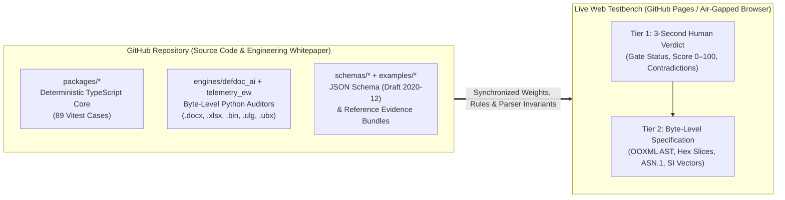

# System Architecture & Deep-Tech Subsystem Breakdown

*[Українською](architecture.md) · English · [Main Repository README](../README.md)*

This document details the internal engineering architecture of **UAV Readiness & Evidence Copilot**: the architectural separation between the live browser testbench and this source repository, the complete repository map, the mathematical foundations of the 6 core verification subsystems, and the deterministic `0–100` readiness evaluation pipeline.

---

## 1. Architectural Separation: Live Web Testbench ⇄ GitHub Repository

The system is intentionally split into two complementary surfaces so rapid daily inspection never obscures the underlying mathematical and byte-level rigor:

1. **[Live Web Testbench (`https://denisshumilov.github.io/uav-readiness-evidence-copilot/`)](https://denisshumilov.github.io/uav-readiness-evidence-copilot/)** — a minimalist client-side inspection interface built around a **Two-Tier Result Presentation**:
   - **Tier 1 (Instant 3-Second Human Verdict):** presents an immediate executive and QA summary — overall readiness score (`0–100`), gate verdict (`READY` / `REQUIRES REMEDIATION` / `BLOCKED`), critical contradiction count, and a plain-language list of mismatched parameters across specification, test protocol, and flight log.
   - **Tier 2 (On-Demand Byte-Level Specification):** expandable technical disclosure blocks (`<details>`) exposing raw OOXML AST nodes, 7D SI dimension vectors, binary telemetry frame slices (`FMT`/`BAT`/`NKF`/`UBX-NAV-SAT`), `ASN.1 DER` certificate trees, and `SHA-256` artifact manifests.
2. **This GitHub Repository (`uav-readiness-evidence-copilot`)** — the complete engineering whitepaper and reference implementation:
   - documents the mathematical formulations and parser invariants across all 6 subsystems;
   - contains the full source code for the client-side JS/WASM modules (`docs/`), standalone Python byte-level auditors (`engines/`), and the typed TypeScript readiness monorepo (`packages/`);
   - enforces cross-surface determinism via **89** Vitest test cases (`packages/qa/src/siteParity.test.ts` and `selfAudit.ts`) plus standalone Python regression suites with zero external runtime dependencies.



---

## 2. Repository Map — Where Everything Lives

```text
uav-readiness-evidence-copilot/
├── docs/                                   # Client-side web testbench, standalone JS/WASM modules & technical docs
│   ├── index.html                          # Main verification testbench hub with 7 specialized engineering tools
│   ├── tools/                              # Standalone verification tool pages
│   ├── tools-engine.js                     # Deterministic readiness scoring, cross-check & parser engine
│   ├── multi-file-verifier-bundle.js       # Multi-artifact cross-verifier (.docx + .xlsx + .pdf + .bin + .p7s)
│   ├── browser-isolation-runtime.js        # Client-side isolated execution runtime for deep inspection
│   ├── pdf-scan-ocr-engine.js              # Beer-Lambert chromatic stamp drop-out & local matrix OCR engine
│   ├── encrypted-report-share.js           # Zero-server report capsule (AES-256-GCM + PBKDF2 in URL #fragment)
│   ├── coi-airgap-enclave-sw.js            # Cross-Origin Isolated Service Worker (COOP/COEP + strict CSP)
│   ├── architecture.md / .en.md            # Deep-tech architectural breakdown & dataflow specification
│   ├── scoring.md / .en.md                 # Mathematical model of the 0–100 readiness score & caps
│   ├── engineering-basis.md / .en.md       # Metrological basis, regulatory context & timing protocols
│   ├── evidence-model.md / .en.md          # Evidence graph model & status derivation rules
│   ├── safety-boundaries.md / .en.md       # Strict operational safety and isolation boundaries
│   └── standards.md / .en.md               # Engineering documentation standards reference (DSTU GOST, STANAG)
│
├── engines/                                # Standalone Python byte-level inspection engines (stdlib only)
│   ├── defdoc_ai/                          # Byte-level OOXML/PDF/P7S document auditor & OPSEC sanitizer
│   │   ├── defdoc_auditor.py               # Orchestrator for TU (.docx), PMV (.xlsx) & passport verification
│   │   ├── document_intake.py              # In-memory OOXML parser, Excel formula AST evaluator & 7D SI vectors
│   │   ├── opsec_sanitizer.py              # Metadata scrubber for docProps/core.xml and w:rsidR revision IDs
│   │   └── prozorro_radar.py               # Structural procurement specification and localization analyzer
│   └── telemetry_ew/                       # Binary flight telemetry & EW resilience analyzer
│       ├── telemetry_analyzer.py           # Binary parser for DataFlash (.bin), PX4 (.ulg), MAVLink, UBX, NMEA
│       ├── sanitize_telemetry.py           # Coherent 7-channel geolocation scrubber preserving kinematics
│       └── hil_simulator.py                # Deterministic binary telemetry generator for regression testing
│
├── packages/                               # TypeScript monorepo (deterministic 0–100 readiness core)
│   ├── core/                               # Domain types, Zod schemas & cross-document revision conflict detector
│   ├── parsers/                            # Deterministic parsers for BOM.csv, manuals (.md), test logs & QA notes
│   ├── evidence/                           # Directed evidence graph builder (requirement → source → check)
│   ├── rules/                              # Status derivation (deriveEvidenceStatuses) & scoring (CONFLICT_CEILING = 49)
│   ├── reports/                            # Markdown, bilingual HTML, CSV traceability, SHA-256 & SARIF 2.1.0 exporters
│   ├── cli/                                # `uav-readiness` CLI binary for local batch audits and CI/CD gates
│   └── qa/                                 # End-to-end CLI tests, browser parity guard (siteParity) & selfAudit
│
├── examples/                               # Reference evidence bundles for deterministic verification
│   ├── demo-uav-readiness/                 # Baseline incomplete evidence bundle (deterministic score: 44/100)
│   ├── demo-maintenance-readiness/         # Maintenance verification bundle (deterministic score: 80/100)
│   ├── demo-conflict-readiness/            # Cross-document revision conflict bundle (capped at: 49/100)
│   └── demo-tdp-supplier-package/          # Supplier TDP bundle with connector spec conflict (capped at: 49/100)
│
└── schemas/                                # Formal JSON Schema specifications (Draft 2020-12)
    ├── evidence-graph.schema.json          # Structural contract for evidence-graph.json
    └── readiness-assessment.schema.json    # Structural contract for readiness-assessment.json
```

---

## 3. Under the Hood: Engineering Breakdown of the 6 Subsystems

### Subsystem 1: Byte-Level OOXML Parsing (`.docx`/`.xlsx`), 7D SI Dimensional Vectors & Excel Formula Cache Verification

Office engineering documents (`.docx` specifications and `.xlsx` test protocols) are **ECMA-376 Open Packaging Conventions** ZIP archives. Rather than relying on lossy plain-text converters, the engine inspects the raw XML streams in memory:

1. **Word Table Grid Reconstruction (`word/document.xml`) & Revision Forensics:**
   - The parser traverses `<w:tbl>` trees while resolving horizontal cell spans (`<w:gridSpan w:val="k"/>`) and vertical merges (`<w:vMerge w:val="restart|continue"/>`) so norm columns and measured values never drift out of alignment.
   - Simultaneously, paragraph and run revision attributes (`w:rsidR`, `w:rsidRPr`) are cross-checked against `docProps/core.xml`. A single acceptance cell carrying an anomalous session `rsidR` inside an otherwise uniform table is flagged as a targeted post-test edit.
2. **Excel Formula AST Recalculation (`xl/worksheets/sheet1.xml`) vs. Cached `<v>`:**
   - Every worksheet cell `<c r="D14">` stores both its formula expression `<f>AVERAGE(D4:D13)</f>` and its last cached scalar value `<v>24.80</v>` (with shared strings resolved via `xl/sharedStrings.xml`).
   - The engine independently evaluates the formula AST (`SUM`, `AVERAGE`, `MIN`, `MAX`, `IF`, `ROUND`, and arithmetic operators) over the referenced source cells.
   - Whenever the cached value disagrees with the recalculated AST beyond floating-point tolerance:
     $$\left| V_{\text{cached}} - f_{\text{AST}}(C_1, \dots, C_n) \right| > \varepsilon \quad (\varepsilon = 10^{-6})$$
     the cell is flagged as a silent XML value tamper (`FORMULA_CACHE_TAMPER`).
3. **Physical Unit Normalization via 7D SI Dimension Vectors:**
   - Every parsed physical quantity is converted into a canonical SI scalar and a 7-dimensional integer exponent vector:
     $$\vec{d} = \begin{bmatrix} M & L & T & I & \Theta & N & J \end{bmatrix} \in \mathbb{Z}^7$$
     representing mass ($\text{kg}$), length ($\text{m}$), time ($\text{s}$), electric current ($\text{A}$), thermodynamic temperature ($\text{K}$), amount of substance ($\text{mol}$), and luminous intensity ($\text{cd}$).
   - Cross-document comparison between a specification requirement $X_{\text{spec}}$ and a logged test measurement $X_{\text{test}}$ is permitted if and only if:
     $$\vec{d}(X_{\text{spec}}) = \vec{d}(X_{\text{test}})$$
     Any attempt to compare incommensurable units (e.g., $\text{A·h}$ with $[0,0,1,1,0,0,0]$ against $\text{W·h}$ with $[1,2,-2,0,0,0,0]$) is immediately blocked as `DIMENSIONAL_MISMATCH`.

---

### Subsystem 2: Beer-Lambert Chromatic Stamp Drop-Out & Local Scanned PDF Recognition

Scanned acceptance protocols frequently contain blue or violet wet ink stamps overlapping black printed digits in test result tables. Standard grayscale thresholding merges the stamp and glyphs into an illegible blot.

1. **Optical Density Transformation (Beer-Lambert Law):**
   For each pixel with RGB channel intensities $I_c(x,y) \in [1, 255]$ and paper white reference $I_{0,c}$, optical density is computed as:
   $$OD_c(x,y) = -\log_{10}\!\left(\frac{\max(I_c(x,y), 1)}{I_{0,c}}\right), \quad c \in \{R, G, B\}$$
   In optical density space, overlapping carbon toner ($\vec{s}_{\text{toner}}$) and blue/violet stamp dye ($\vec{s}_{\text{stamp}}$) combine linearly:
   $$\vec{OD}(x,y) = c_{\text{toner}}(x,y)\,\vec{s}_{\text{toner}} + c_{\text{stamp}}(x,y)\,\vec{s}_{\text{stamp}}$$
2. **Chromatic Subspace Projection (`Chromatic Stamp Drop-Out`):**
   Because blue/violet stamp ink absorbs strongly in the red channel while transmitting in the blue channel ($I_R \ll I_B$), whereas black carbon toner absorbs uniformly across all channels, projecting out the chromatic stamp component restores the underlying black glyphs:
   $$I_{\text{clean}}(x,y) = \operatorname{clamp}\!\left(I_R(x,y) + \alpha \cdot \max\!\big(0,\, I_B(x,y) - I_R(x,y)\big),\, 0,\, 255\right)$$
3. **Local Glyph Matrix Recognition:**
   Connected components in the cleaned binary image are classified by a deterministic local glyph-matrix correlator without external cloud OCR calls.

---

### Subsystem 3: Binary Flight Log Parsers (`.bin`, `.ulg`, `.tlog`, `.ubx`, `.nmea`), Spoofing Detection & Hardware Verification

1. **Binary Frame Signatures & Stream Self-Healing:**
   - **ArduPilot DataFlash (`.bin`):** sync bytes `0xA3 0x95`, self-describing `FMT` descriptors (`0x80`, `89 B` payload defining message ID, length, format string, and column labels), plus `UNIT`/`MULT`/`FMTU` scaling metadata.
   - **PX4 ULog (`.ulg`):** 8-byte magic header `0x55 0x4C 0x6F 0x67 0x01 0x12 0x35` followed by `uint64` start timestamp and structured `F`/`A`/`R`/`D` records.
   - **MAVLink v2 (`.tlog`):** magic byte `0xFD`, 24-bit message IDs, `(sysid, compid)` stream demultiplexing, and `CRC-16/MCRF4XX` validation with `CRC_EXTRA`.
   - **u-blox UBX (`.ubx`) & NMEA (`.nmea`):** UBX preamble `0xB5 0x62` with 8-bit Fletcher checksums (`CK_A`, `CK_B`) for `NAV-PVT`, `NAV-SAT`, `NAV-STATUS`, `MON-HW`; NMEA `$GP/$GN` sentences with `XOR` checksum verification.
   - **Tail-Corruption Recovery:** if power loss truncates the final flash sector, the parser scans forward to resynchronize on the next valid frame header while isolating corrupted tail bytes.
2. **GNSS Spoofing Cross-Verification (`spoofDetState` vs. 8-Channel `CN0` in `UBX-NAV-SAT`):**
   Single-antenna GNSS spoofers broadcast multiple satellite signals from a common power amplifier. The analyzer cross-checks the receiver's `spoofDetState` flag against the inter-satellite carrier-to-noise ratio dispersion across $K \ge 8$ tracked satellites in `UBX-NAV-SAT`:
   $$\sigma_{CN0} = \sqrt{\frac{1}{K}\sum_{i=1}^{K}\left(CN0_i - \overline{CN0}\right)^2}$$
   An unnaturally flat distribution ($\sigma_{CN0} < 1.0\text{ dB-Hz}$ at high mean power $\overline{CN0} > 42\text{ dB-Hz}$ across low and high elevation angles) flags single-source RF synthesis.
3. **Battery Internal Resistance ($R_{\text{int}}$), `STM32 Unique ID` & Ballistic CEP:**
   - **Electrochemical Internal Resistance:** computed from step-throttle voltage sag and current draw in `BAT` frames:
     $$R_{\text{int}} = \left|\frac{\Delta V}{\Delta I}\right| = 71.88\text{ m}\Omega$$
   - **Hardware Controller Fingerprinting:** extracts the `STM32 96-bit Unique Device ID` (`3 × 32-bit` silicon wafer/lot/coordinates words) to detect reuse of a single bench flight log across multiple serial numbers.
   - **Ballistic Dispersion & Terminal Kinematics:** integrates dead-reckoning trajectory equations under GNSS denial to verify Circular Error Probable $\text{CEP (СКВ)} \in [35, 80]\text{ m}$ and terminal impact velocity $v_{\text{impact}} \ge 27\text{ m/s}$.

---

### Subsystem 4: Cryptographic Digital Signature Parsing (`.p7s`, `ASN.1 DER`, `DSTU 4145-2002` / `GOST 34.311-95`)

The byte-level `ASN.1 DER` (`Tag-Length-Value`) parser inspects detached/attached `CMS SignedData` (`OID 1.2.840.113549.1.7.2`) signature containers:
- validates curve and digest OIDs (`DSTU 4145-2002` polynomial basis `1.2.804.2.1.1.1.1.3.1.1` and `GOST 34.311-95` `1.2.804.2.1.1.1.1.2.1`);
- extracts signer X.509v3 certificate attributes (`CN`, `O`, enterprise registry code `EDRPOU`, and tax ID `RNOKPP`);
- verifies embedded `RFC 3161 TimeStampToken` (`OID 1.2.840.113549.1.9.16.2.14`) authority signatures to prevent backdated test protocol signing.

---

### Subsystem 5: Deep OPSEC Sanitization Across 7 Secondary Geolocation Channels

Simply deleting `GPS` messages from a flight log leaves test range coordinates exposed. The sanitizer (`sanitize_telemetry.py` and `opsec_sanitizer.py`) performs a coherent coordinate-frame translation across all **7 secondary geolocation channels**:
1. `ORGN` — EKF origin latitude, longitude, and altitude;
2. `HOME` — return-to-launch coordinates latched at arming;
3. `CMD` — uploaded mission waypoint coordinates;
4. `TERR` — SRTM terrain elevation tile hashes and indices;
5. `LPOS` / `NKF1` — local NED Cartesian grid origin offsets;
6. Barometric absolute launch altitude (`ASL` normalized to relative `AGL` profile $\Delta h(t) = h(t) - h(t_0)$);
7. Document package metadata (`docProps/core.xml` creator/company tags and `w:rsidR` editing session identifiers).

---

### Subsystem 6: Deterministic Readiness Scoring `0–100` (`CONFLICT_CEILING = 49`) & Zero-Server Encrypted Sharing (`AES-256-GCM`)

1. **Readiness Score Formula (`packages/rules/src/readiness.ts`):**
   $$S_{\text{raw}} = 100 - \min(6 \cdot N_{\text{locked}},\, 48) - \min(8 \cdot N_{\text{conflict}},\, 24) - \min(3 \cdot N_{\text{partial}},\, 24) - \min(2 \cdot N_{\text{warn}},\, 16) - \min(10 \cdot N_{\text{missing}},\, 30)$$
   If any active contradiction exists between documents ($N_{\text{conflict}} > 0$), the score is strictly capped at **`CONFLICT_CEILING = 49`** (`Blocked`), ensuring conflicting evidence can never pass as review-ready.
2. **Air-Gap Service Worker & `AES-256-GCM` URL Fragment Capsule (`RFC 3986`):**
   - `docs/coi-airgap-enclave-sw.js` enforces `COOP: same-origin` and `COEP: require-corp` headers.
   - `docs/encrypted-report-share.js` encrypts verification reports in-browser using WebCrypto `AES-256-GCM` (`PBKDF2-HMAC-SHA256`, `100,000` iterations, 128-bit salt, 96-bit IV) and places the Base64URL payload inside the URL `#fragment`, which per **RFC 3986 Section 3.5** is never transmitted in HTTP requests.

---

## ⚖️ Public Web Testbench Boundaries & Custom Enterprise Calibration (Scope & Calibration Matrix)

*(Межі публічного веб-стенду та індивідуальне калібрування під КБ — Scope & Calibration Matrix)*

The public web testbench and CLI engines are engineered around **strict epistemic honesty (`Honest UNVERIFIED`)**: the baseline browser parser processes standard document tables and binary flight logs in RAM in real time, while intentionally refusing to "guess" complex custom enterprise layouts or proprietary frames—transparently marking them as `UNVERIFIED` until calibrated for a specific design bureau (KB).

### Contour 1. Document Tables & Prose (`.docx`, `.xlsx`, `.csv`, `.txt`)
* **🟢 Live on Public Testbench (`Live Browser & CLI`)**: in-memory ZIP/OOXML decompression (`DecompressionStream("deflate-raw")` + synchronous RFC 1951 inflate), `<w:tbl>` table parsing with automatic subsystem banner detection ("АКБ", "Пульт керування") and 4-column spare-parts (ZIP) schedules, 12 extraction rules for numerical UAV specifications from continuous Ukrainian prose, editing session forensics via `w:rsid` (`ORPHAN_DONOR`, late-night `POINT_EDIT` insertions) and external tracking beacons `TargetMode="External"`, auto-detection of shifted 1C/BAS Excel headers (rows `1..15`), multi-pass formula evaluation (`SUM/MIN/MAX/AVERAGE`) over vertical ranges with `<f> vs <v>` cache tamper detection (`CYBER-XLSX-CACHE-SPOOF`), automatic `Windows-1251 (CP1251)` and `UTF-16` transcoding, 7D SI physical dimension mask `[L, M, T, I, Θ, N, J]`, and the Kuhn-Munkres (Hungarian) algorithm for semantic parameter alignment.
* **🟡 Exact Algorithmic Boundary of the Public Testbench (`Honest UNVERIFIED`)**:
  1. When an enterprise uploads a custom 90-page `.docx` with deeply nested multi-row merged headers (`w:gridSpan > 1`, `w:vMerge`), nested sub-tables, or tables embedded as vector/OLE objects (`w:drawing`, `EMF/WMF`, `OLE`), or an `.xlsx` with sparse skipped intermediate columns (`sparseRow`) — the baseline browser parser **intentionally refuses to guess** the grid topology and marks those fields as `UNVERIFIED`;
  2. Complex Excel formulas (`VLOOKUP`, `INDEX/MATCH`, `SUMIFS`, `IF`, cross-sheet references `Sheet2!B5`, horizontal ranges) are marked as `UNVERIFIED` in the browser;
  3. Domain-specific enterprise abbreviations outside standard SI units (`dBi`, `КСХ/VSWR`, `RPM`, `Па`, `кд/м²`, `мрад`) are marked as `UNVERIFIED`.
* **🔵 Custom Enterprise Calibration in 2–3 Days (`Custom Calibration`)**: tailored unfolding profile for complex 3–4-level merged headers (`gridSpan/vMerge`) matching the plant's specific TU/PMV templates (DSTU GOST 2.105 / 2.114), extended domain unit and nomenclature dictionary, and a local Python cross-sheet Excel formula evaluator.

### Contour 2. PDF Documents & Browser WASM OCR for Wet-Stamped Scans
* **🟢 Live on Public Testbench (`Live Browser & WASM`)**: client-side vector `.pdf` decompiler (`/FlateDecode` streams, `Tj`/`TJ` text operators, `/Info` metadata), raster XObject extraction, HSV chromatic filtering of blue/violet wet acceptance stamps (`Hue 200°..265°`, `circularityScore >= 0.85` across 36 angular sectors) preserving underlying black laser toner (`Chromatic Stamp-Drop-Out`), and a compiled WebAssembly core (`otsuThresholdSum` for global Otsu binarization + 64-bit Hamming distance `hammingDistance64` via hardware `i32.popcnt` on a reference `8×8` glyph grid).
* **🟡 Exact Algorithmic Boundary of the Public Testbench**:
  1. Vector PDFs using `CIDFont / Type0 (Identity-H)` fonts with two-byte glyph indices `<001A...> Tj` requiring `/ToUnicode CMap` decoding, or raster streams compressed with `/JBIG2Decode`, `/CCITTFaxDecode`, or PNG predictors (`/Predictor 12/15`), are transparently marked as `UNVERIFIED` in the browser;
  2. The embedded `pdf-scan-ocr-engine.js` is a lightweight browser demonstration of chromatic stamp drop-out and binary WASM glyph matching on an aligned reference scan (`560×220 px`), not a full industrial Tesseract / ABBYY pipeline. If a user uploads a crumpled sheet photographed on a smartphone at a skew angle `> ±1..3°`, with uneven lateral shadows or handwritten annotations over text, global Otsu thresholding and the fixed grid will mark characters as `#` / `UNVERIFIED`.
* **🔵 Custom Enterprise Calibration in 2–3 Days (`Custom Calibration`)**: air-gapped on-premise deployment of a local Python/C++ pipeline (`MuPDF`/`pdfminer` for arbitrary `CIDFont/ToUnicode` + Hough/homography perspective deskewing + adaptive local Sauvola binarization against shadows + local neural OCR engine for 300 DPI Cyrillic DSTU tables with zero cloud API calls).

### Contour 3. Flight Logs (`.bin`, `.ulg`, `.tlog`, `.ubx`, `.nmea`) & EW / GNC Scenarios
* **🟢 Live Real-Time Parsing on Arbitrary User Files (`Live File Drop`)**:
  - `ArduPilot .bin`: `0xA3 0x95` header check, dynamic parsing of the self-describing `FMT (id=128)` schema table and `GPS` packets (altitude, ground speed, vertical rate `maxVRate`, plus barometric `ATT` cross-check in Python CLI);
  - `PX4 .ulg`: `ULog\x01\x12\x35` magic verification, parsing of `'F'/'A'/'I'/'P'` definitions and binary `'D'` data records (`vehicle_gps_position`, `vehicle_local_position`);
  - `MAVLink .tlog`: auto-detection of v1 (`0xFE`) and v2 (`0xFD`) with 8-byte QGC timestamps and 13-byte v2 signatures, decoding `#24 GPS_RAW_INT` and `#33 GLOBAL_POSITION_INT`;
  - `u-blox .ubx`: byte-level `0xB5 0x62` sync and `Fletcher-8 (CK_A, CK_B)` checksum verification, decoding `UBX-NAV-PVT`, `UBX-NAV-STATUS` (`spoofDetState`), `UBX-NAV-CLOCK` (`clkB`, `clkD`), `UBX-NAV-SAT` (`C/N0` profiles and `130°..150° SE` shadow sector), `UBX-MON-HW` (`agcCnt`, `jamInd`);
  - `NMEA 0183 / 4.10`: `*XOR` checksum validation, `GGA/RMC/GSA/GSV/$PUBX` parsing, and `C/N0` variance collapse detection `std(C/N0) < 1.85 dB-Hz`;
  - **Live PMV ⇄ Log Cross-Verification**: automatic comparison of altitude and speed claimed in `.docx`/`.xlsx` against actual binary flight log peaks + byte-level stream resynchronization (`0xB5 0x62` + Fletcher-8).
* **🟡 Pre-Computed Reference Simulation Cases on the Public Testbench (`Pre-Computed Reference Simulation Cases` via preset buttons)**:
  - 63-ray non-linear Gauss-Newton inversion across a 744-bank synthetic antenna aperture (`jammer slant range 419.97 m`, `EIRP 19.95 W`, `CEP95 = 4.66 m`);
  - 30-second coherent GPS spoofing pull-off simulation over `1,942.12 m` with Page's `CUSUM NIS` test and `CEP (СКВ) ±35..80 m` search ellipse;
  - Deep forensic presets for reference logs `log171.bin` / `sample.ulg` / `flight.tlog` (`STM32 Wafer UID`, battery internal resistance `R_int = 71.88 mΩ` from `CURR`, subterranean EKF divergence `EKF1.PD = -15.26 m`, `#35 RC_CHANNELS` vs `#36 SERVO_OUTPUT` conflict).
* **🔵 Custom Enterprise Calibration in 2–3 Days (`Custom Calibration`)**: wiring full live decoding of `BAT/CURR`, `VIBE`, `EKF1/NKF1/XKF1`, `RCOU`, `ORGN/CMD/AHR2`, raw carrier-phase `UBX-RXM-RAWX`, **custom vendor `MAVLink msgId 180..255` dialects**, and a live `CUSUM NIS` / Gauss-Newton solver calibrated to the airframe's specific geometry, antenna radiation pattern, and INS.

### Contour 4. Offline QES Signature Inspector (`.p7s`) & OPSEC Sanitizer
* **🟢 Live on Public Testbench (`Live Browser & CLI`)**: browser `.p7s` parser unpacks Base64/ASN.1 DER (`CMS SignedData`, OID `1.2.840.113549.1.7.2` and `DSTU 4145-2002` `1.2.804.2.1.1.1`), extracting signer full name, EDRPOU/DRFO code, CA (KNEDP) issuer name, and UTC timestamp. The browser OPSEC sanitizer scrubs NMEA streams (recomputing valid `*XOR` checksums) and document text (WGS-84, MGRS, military unit `в/ч` codes, EDRPOU, full names, `STM32 UID`), while the Python CLI `sanitize_telemetry.py` overwrites coordinates byte-for-byte in binary `.bin`, `.ulg`, `.ubx` (recomputing Fletcher-8) and `.nmea` logs.
* **🟡 Exact Algorithmic Boundary of the Public Testbench**:
  1. Due to 100% offline air-gap isolation, the browser never contacts external OCSP/CRL servers of the Central Certification Authority (does not check live certificate revocation) and does not evaluate the `DSTU 4145-2002` elliptic curve over an external detached file (`detached signature`);
  2. In the browser UI, sanitized binary logs are exported as a scrubbed `.txt` report, while the byte-level scrubber `sanitize_telemetry.py` overwrites primary `GPS (130)` / `vehicle_gps_position` frames by default, whereas secondary non-GPS channels (`ORGN`, `CMD`, `AHR2`, `POS`, `LPE_LAT`) require dynamic `FMT`/`'F'` schema mapping.
* **🔵 Custom Enterprise Calibration in 2–3 Days (`Custom Calibration`)**: local offline cryptographic verification of `DSTU 4145-2002` signatures / `GOST 34.311-95` digests for `Document + .p7s` pairs using an air-gapped USB `CRL` cache + 7-channel byte-for-byte binary scrubber for `.bin/.ulg/.tlog` and lossless `.docx/.xlsx` repackaging preserving 100% of enterprise formatting.

---

## 4. Quick Start, CLI Commands & Automated Test Suites

### Run TypeScript Monorepo Verification (**89** Vitest tests + Self-Audit)
```bash
npm install
npm test
npm run demo:selfaudit
npm run lint
npm run typecheck
```

### Run Standalone Python Byte-Level Engines
```bash
python3 engines/defdoc_ai/defdoc_auditor.py --self-test
python3 engines/defdoc_ai/defdoc_auditor.py --test-client
python3 engines/defdoc_ai/defdoc_auditor.py --benchmark
python3 engines/telemetry_ew/telemetry_analyzer.py --self-test
```
