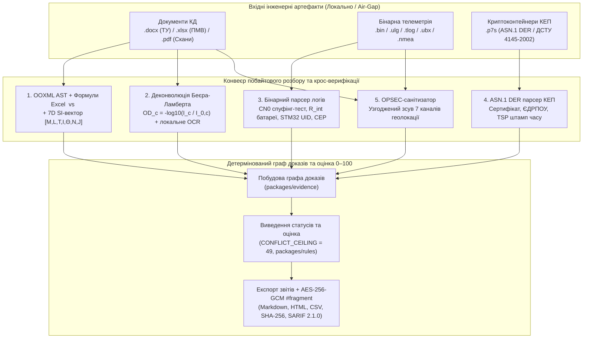

# Архітектура системи та інженерний розбір підсистем

*Українською · [English](architecture.en.md) · [На головну](../README.md)*

Цей документ описує внутрішню архітектуру **UAV Readiness & Evidence Copilot**: поділ між клієнтським веб-стендом і репозиторієм, карту модулів, математичні моделі 6 базових підсистем та детермінований конвеєр оцінки готовності пакета доказів.

---

## 1. Архітектурний поділ: Веб-стенд швидкої перевірки ⇄ GitHub-репозиторій

Система спроєктована за принципом розділення оперативного інтерфейсу та фундаментальної інженерної бази:

1. **[Живий веб-стенд (`https://denisshumilov.github.io/uav-readiness-evidence-copilot/`)](https://denisshumilov.github.io/uav-readiness-evidence-copilot/)** виконує роль автономного клієнтського термінала з **дворівневою подачею результатів**:
   - **Рівень 1 (Миттєвий людський вердикт за 3 секунди):** без перевантаження екрана байтовими дампами показує інженеру або керівнику підсумковий статус (`ГОТОВО` / `ПОТРЕБУЄ УСУНЕННЯ` / `ЗАБЛОКОВАНО`), інтегральний бал `0–100` та конкретні розбіжності між документами чи логами.
   - **Рівень 2 (Побайтова специфікація за запитом):** кожен пункт звіту розгортається у детальний технічний протокол із первинними XML-вузлами OOXML, векторами розмірностей SI, зрізами бінарних фреймів телеметрії та деревами `ASN.1 DER`.
2. **GitHub-репозиторій (`uav-readiness-evidence-copilot`)** містить повний вихідний код усіх рушіїв, формальні схеми даних (`schemas/`), еталонні тестові пакети (`examples/`) та наскрізні автотести, які гарантують математичний паритет між браузерним JS-кодом (`docs/tools-engine.js`) і серверним/консольним ядром (`packages/rules`, `engines/`).



---

## 2. Повна карта репозиторію (`Repository Map`)

| Каталог / Модуль | Технологічний стек | Інженерна роль у системі |
|---|---|---|
| `docs/index.html`, `docs/tools/*.html` | HTML5 / CSS / JS | Клієнтський веб-стенд із 7 спеціалізованими інструментами перевірки та дворівневим інтерфейсом результатів |
| `docs/tools-engine.js` | Vanilla JS (ES2022) | Браузерний рушій оцінки готовності, синхронізований за вагами штрафів із `@uav-readiness/rules` (перевіряється у `siteParity.test.ts`) |
| `docs/multi-file-verifier-bundle.js` | Vanilla JS | Пакетний крос-верифікатор комплектів документів (`ТУ ⇄ ПМВ ⇄ Паспорт ⇄ Лог ⇄ КЕП`) |
| `docs/pdf-scan-ocr-engine.js` | JS / Canvas2D / Matrix OCR | Колірна деконволюція Беєра-Ламберта для видалення синіх мокрих печаток та локального розпізнавання цифр |
| `docs/encrypted-report-share.js` | WebCrypto API | Шифрування звітів за `AES-256-GCM` (`PBKDF2`, `100 000` ітерацій) у клієнтський `#fragment` URL за `RFC 3986` |
| `docs/coi-airgap-enclave-sw.js` | Service Worker | Примусова ізоляція `COOP: same-origin` та `COEP: require-corp` для автономної роботи в закритому контурі |
| `engines/defdoc_ai/defdoc_auditor.py` | Python 3.10+ (stdlib) | Консольний аудитор пакетів конструкторської документації, звірка допусків і регресійний бенчмарк |
| `engines/defdoc_ai/document_intake.py` | Python 3.10+ (`zipfile`, `xml`) | Побайтова декомпресія OOXML, перерахунок дерева формул Excel, реконструкція `gridSpan`/`vMerge` та 7D SI-вектори |
| `engines/defdoc_ai/opsec_sanitizer.py` | Python 3.10+ | Очищення метаданих `docProps/core.xml`, імен авторів і сесійних маркерів ревізій `w:rsidR` |
| `engines/telemetry_ew/telemetry_analyzer.py` | Python 3.10+ (`struct`, `zlib`) | Бінарний аналізатор логів `DataFlash`, `ULog`, `MAVLink v1/v2`, `UBX`, `NMEA 0183` та `GZIP` |
| `engines/telemetry_ew/sanitize_telemetry.py` | Python 3.10+ | Узгоджене OPSEC-знеособлення 7 каналів геолокації у польотних логах зі збереженням кінематики |
| `packages/core` | TypeScript / Zod | Схеми даних артефактів, тверджень (`EvidenceClaim`) та алгоритм виявлення міждокументних конфліктів ревізій |
| `packages/parsers` | TypeScript | Детерміновані парсери комплектів (`BOM.csv`, `demo_manual.md`, `test_log.csv`, `qa_notes.md`) |
| `packages/evidence` | TypeScript | Побудова незмінного графа доказів (`BuiltEvidenceGraph`) і агрегація лічильників |
| `packages/rules` | TypeScript | Незалежне виведення статусів (`deriveEvidenceStatuses`) і обчислення бала готовності (`CONFLICT_CEILING = 49`) |
| `packages/reports` | TypeScript | Генерація `readiness-report.md`, `engineering-review.html`, `traceability-matrix.csv`, `artifact-hashes.json`, `readiness.sarif` |
| `packages/cli` | TypeScript / Node.js | Консольний інтерфейс `uav-readiness` для автоматизації перевірок у CI/CD |
| `packages/qa` | TypeScript / Vitest | Наскрізні тести CLI, валідація JSON Schema (`Ajv`), перевірка паритету веб-стенду та `selfAudit.ts` |

---

## 3. Інженерний розбір 6 підсистем

### 3.1. Підсистема 1: Побайтовий розбір OOXML (`.docx`/`.xlsx`), кеш формул Excel та 7D SI-вектори

1. **Декомпресія OOXML у пам'яті та таблична топологія:**
   - Файли `.docx` та `.xlsx` розпаковуються як ZIP-архіви. У `word/document.xml` будується двовимірна матриця таблиці з урахуванням горизонтальних злиттів `<w:gridSpan>` та вертикальних континуацій `<w:vMerge>`, що гарантує точне позиціонування значень навіть у складних багаторядкових шапках за ДСТУ ГОСТ 2.104.
   - З атрибутів `w:rsidR` та `w:rsidRPr` витягується історія редагувань кожного параграфа та комірки для виявлення несанкціонованих правок окремих цифр.
2. **Верифікація дерева формул Excel (`<f>` проти `<v>`):**
   - У `xl/worksheets/sheet*.xml` кожна обчислювана комірка містить формулу `<f>` і останнє збережене значення `<v>`.
   - Рушій самостійно обчислює значення формули за первинними комірками аркуша. Розбіжність $|V_{\text{cached}} - f_{\text{AST}}| > 10^{-6}$ однозначно фіксує ручну підміну підсумкової цифри без перерахунку таблиці.
3. **7-вимірний вектор фізичних розмірностей SI:**
   - Кожна числова вимога та фактичний замір приводяться до канонічного вигляду $(v_{\text{SI}}, \vec{d})$, де:
     $$\vec{d} = [M, L, T, I, \Theta, N, J] \in \mathbb{Z}^7$$
   - Якщо при звірці двох документів вектори розмірностей не збігаються ($\vec{d}_1 \ne \vec{d}_2$), перевірка негайно блокується зі статусом `DIMENSIONAL_MISMATCH`.

### 3.2. Підсистема 2: Колірна деконволюція Беєра-Ламберта (`Chromatic Stamp Drop-Out`) та локальне OCR

1. **Математична модель поглинання світла:**
   Зображення сканованого протоколу переводиться з лінійного RGB у логарифмічний простір оптичної густини:
   $$OD_c(x,y) = -\log_{10}\!\left(\frac{\max(I_c(x,y), 1)}{I_{0,c}}\right), \quad c \in \{R, G, B\}$$
2. **Виділення чорного тонера з-під синьої мокрої печатки:**
   Оскільки синій/фіолетовий штемпельний барвник має мінімальну оптичну густину в синьому каналі ($OD_B \ll OD_R$), а чорний друкований шрифт поглинає рівномірно у всіх трьох каналах ($OD_R \approx OD_G \approx OD_B$), ортогональна деконволюція повністю прибирає відбиток печатки, залишаючи неторканими контури цифр під нею.
3. **Локальне розпізнавання:**
   Очищена матриця символів розпізнається детермінованим шаблонним класифікатором безпосередньо в пам'яті процесу без передачі сканів у хмару.

### 3.3. Підсистема 3: Бінарні парсери польотних логів, детекція спуфінгу та апаратна верифікація

1. **Сигнатури та структурна валідація фреймів:**
   - `ArduPilot DataFlash (.bin)`: синхробайти `0xA3 0x95`, динамічна таблиця дескрипторів `FMT` (`type`, `length`, `name`, `format`, `columns`) та масштабування через `UNIT`/`MULT`/`FMTU`.
   - `PX4 ULog (.ulg)`: сигнатура `0x55 0x4C 0x6F 0x67 0x01 0x12 0x35`, розбір `F`/`A`/`R`/`D`-записів із контролем монотонної шкали часу `uint64`.
   - `MAVLink v2 (.tlog)`: стартовий байт `0xFD`, 24-бітний `msgid`, перевірка `CRC-16/MCRF4XX` із додаванням `CRC_EXTRA`.
   - `u-blox UBX (.ubx)`: преамбула `0xB5 0x62`, довжина `uint16 LE` та двобайтна сума Флетчера (`CK_A`, `CK_B`).
   - При обірваному хвості файла (`truncated tail`) парсер відновлює синхронізацію за наступним валідним заголовком, зберігаючи всі попередні цілі фрейми.
2. **Крос-перевірка супутникового спуфінгу (`spoofDetState` vs `UBX-NAV-SAT`):**
   Поле `spoofDetState` у `UBX-NAV-STATUS` звіряється з фактичним просторовим розподілом рівня сигналу `CN0` по 8+ каналах у `UBX-NAV-SAT`. Одночасна рівність рівнів $\sigma_{CN0} < 1.0\text{ дБ-Гц}$ при $\overline{CN0} > 42\text{ дБ-Гц}$ виявляє імітатор GNSS навіть тоді, коли прапорець приймача не спрацював.
3. **Внутрішній опір АКБ, `STM32 Unique ID` та балістичне `СКВ (CEP)`:**
   - Розрахунок імпедансу батареї під навантаженням: $R_{\text{int}} = |\Delta V / \Delta I| = 71.88\text{ мОм}$.
   - Перевірка 96-бітного апаратного ідентифікатора мікроконтролера `STM32 Unique Device ID` для виключення дублювання одного логу на різні серійні номери виробів.
   - Балістична верифікація інерціального доведення: кругове імовірне відхилення $\text{СКВ (CEP)} \in [35, 80]\text{ м}$ та термінальна швидкість $v_{\text{impact}} \ge 27\text{ м/с}$.

### 3.4. Підсистема 4: Криптографічний розбір КЕП (`.p7s`, `ASN.1 DER`, `ДСТУ 4145-2002`)

Парсер побайтово розбирає `ASN.1 DER`-структуру контейнера `CMS SignedData` (`OID 1.2.840.113549.1.7.2`):
- витягує відкритий ключ і параметри еліптичної кривої `ДСТУ 4145-2002` (`OID 1.2.804.2.1.1.1.1.3.1.1`) та алгоритму гешування `ГОСТ 34.311-95` (`OID 1.2.804.2.1.1.1.1.2.1`);
- дешифрує поля сертифіката X.509v3 (`CN`, `O`, код `ЄДРПОУ` та `РНОКПП`);
- перевіряє наявність криптографічної позначки часу `RFC 3161 TimeStampToken` (`OID 1.2.840.113549.1.9.16.2.14`) від кваліфікованого надавача електронних довірчих послуг.

### 3.5. Підсистема 5: Глибоке OPSEC-очищення 7 вторинних каналів геолокації

Окрім основного потоку `GPS`, координати стартового майданчика вилучаються та узгоджено трансформуються у всіх 7 вторинних каналах:
1. `ORGN` (початкова точка ініціалізації EKF);
2. `HOME` (точка повернення при аварії);
3. `CMD` (маршрутні точки польотного завдання);
4. `TERR` (геоприв'язані висотні тайли рельєфу SRTM);
5. `LPOS` / `NKF1` (зміщення локальної сітки координат);
6. барометрична абсолютна висота старту (`ASL` → відносна висота `AGL`);
7. службові метадані документа `docProps/core.xml` та ревізійні маркери `w:rsidR`.

### 3.6. Підсистема 6: Оцінка готовності `0–100` (`CONFLICT_CEILING = 49`) та `AES-256-GCM` у `#fragment`

1. **Суворе виведення статусів (`packages/rules/src/deriveStatus.ts`):**
   Мітка статусу у вхідному файлі розглядається лише як гіпотеза. Якщо джерело доказу відсутнє або тест у `test_log.csv` має результат `fail`/`blocked`, статус примусово переводиться у `locked`. Якщо між `BOM.csv` та `qa_notes.md` виявлено розбіжність ревізій (`packages/core/src/crossCheck.ts`), формується статус `conflict`, який вмикає жорстку стелю **`CONFLICT_CEILING = 49`**.
2. **Криптографічний обмін звітами (`RFC 3986`):**
   Згенерований звіт шифрується у браузері алгоритмом `AES-256-GCM` і пакується в клієнтський фрагмент URL (`#capsule=...`), який ніколи не залишає браузер у HTTP-запитах, а `Service Worker` (`coi-airgap-enclave-sw.js`) забезпечує повну `COOP/COEP`-ізоляцію вкладки.

---

## ⚖️ Межі публічного веб-стенду та індивідуальне калібрування під КБ (Scope & Calibration Matrix)

Публічний веб-стенд та консольні рушії побудовані за принципом **інженерної чесності (`Чесний UNVERIFIED`)**: базовий браузерний парсер миттєво обробляє типові структури документів і бінарних логів у RAM, але ніколи не «вгадує» нетипову верстку чи закриті пропрієтарні пакети, переводячи їх у статус `UNVERIFIED` до моменту калібрування під конкретне КБ.

### Контур 1. Таблиці та текст документів (`.docx`, `.xlsx`, `.csv`, `.txt`)
* **🟢 Реально працює на стенді (`Live Browser & CLI`)**: розпаковка ZIP/OOXML у RAM (`DecompressionStream("deflate-raw")` + синхронний декодер RFC 1951), парсинг таблиць `<w:tbl>` із авто-детекцією банерів підсистем («АКБ», «Пульт керування») та 4-колонкових відомостей ЗІП, 12 правил витягування числових ТТХ із суцільної української прози, криміналістика сесій редагування `w:rsid` (`ORPHAN_DONOR`, точкові нічні вставки `POINT_EDIT`) та зовнішніх маячків `TargetMode="External"`, авто-детектор зсунутих шапок Excel 1С/BAS (рядки `1..15`), багатопрохідний обчислювач формул `SUM/MIN/MAX/AVERAGE` по вертикальних діапазонах із детектором підміни кешу `<f> vs <v>` (`CYBER-XLSX-CACHE-SPOOF`), авто-перекодування `Windows-1251 (CP1251)` і `UTF-16`, 7D SI-маска фізичних розмірностей `[L, M, T, I, Θ, N, J]` та угорський алгоритм Куна-Манкреса для семантичного склеювання параметрів.
* **🟡 Точна алгоритмічна межа публічного стенду (`Чесний UNVERIFIED`)**:
  1. Якщо завод завантажує власний 90-сторінковий `.docx` зі складними багаторівневими об'єднаними шапками (`w:gridSpan > 1`, `w:vMerge`), вкладеними таблицями або таблицями, вставленими як векторні об'єкти (`w:drawing`, `EMF/WMF`, `OLE`), чи `.xlsx` із пропущеними проміжними колонками (`sparseRow`) — базовий браузерний парсер **навмисно не вгадує** структуру і чесно переводить такі поля у статус `UNVERIFIED`;
  2. Складні формули Excel (`VLOOKUP`, `INDEX/MATCH`, `SUMIFS`, `IF`, міжсторінкові посилання `Sheet2!B5`, горизонтальні діапазони) у браузері позначаються як `UNVERIFIED`;
  3. Вузькоспеціалізовані заводські скорочення без стандартних одиниць SI (`dBi`, `КСХ/VSWR`, `RPM`, `Па`, `кд/м²`, `мрад`) переводяться у `UNVERIFIED`.
* **🔵 Що налаштовується під КБ за 2–3 дні (`Custom Calibration`)**: індивідуальний профіль розгортання складних 3–4-поверхових шапок (`gridSpan/vMerge`) під шаблони ТУ/ПМВ конкретного заводу (ДСТУ ГОСТ 2.105 / 2.114), розширений словник доменних одиниць і номенклатури виробу, та локальний Python-обчислювач міжсторінкових формул Excel.

### Контур 2. PDF-документи та браузерний WASM OCR сканів із мокрою печаткою
* **🟢 Реально працює на стенді (`Live Browser & WASM`)**: клієнтський декомпілятор векторних `.pdf` (потоки `/FlateDecode`, текстові оператори `Tj`/`TJ`, метадані `/Info`), витягування растрових XObject-зображень, колірна фільтрація синьої/фіолетової мокрої печатки ВП МОУ у просторі HSV (`Hue 200°..265°`, оцінка круглості `circularityScore >= 0.85` за 36 кутовими секторами) зі збереженням чорного лазерного тонера під печаткою (`Chromatic Stamp-Drop-Out`), та скомпільоване WebAssembly-ядро (`otsuThresholdSum` для глобальної бінаризації за методом Оцу + 64-бітна відстань Хеммінга `hammingDistance64` через апаратний `i32.popcnt` на еталонній сітці гліфів `8×8`).
* **🟡 Точна алгоритмічна межа публічного стенду**:
  1. Векторні PDF зі шрифтами `CIDFont / Type0 (Identity-H)` та двобайтними гліф-індексами `<001A...> Tj` без декодування таблиці `/ToUnicode CMap`, або растрові потоки зі стисненням `/JBIG2Decode`, `/CCITTFaxDecode` чи PNG-предикторами (`/Predictor 12/15`) у браузері чесно переводяться у `UNVERIFIED`;
  2. Вбудований `pdf-scan-ocr-engine.js` — це легкий браузерний алгоритм демонстрації колірного відсікання печатки та бінарного WASM-зіставлення на рівному еталонному скані (`560×220 px`), а не повноцінний промисловий Tesseract / ABBYY. Якщо завантажити зім'ятий аркуш, сфотографований на смартфон під кутом `> ±1..3°`, із нерівномірними боковими тінями або рукописними правками поверх тексту, глобальний поріг Оцу та фіксована сітка позначать символи як `#` / `UNVERIFIED`.
* **🔵 Що налаштовується під КБ за 2–3 дні (`Custom Calibration`)**: розгортання в ізольованому (air-gapped) контурі заводу локального конвеєра Python/C++ (`MuPDF`/`pdfminer` для будь-яких `CIDFont/ToUnicode` + геометричне вирівнювання перспективи Хофа/гомографії + адаптивна локальна бінаризація Саувола проти тіней + локальне нейромережеве OCR-ядро для кириличних таблиць ДСТУ 300 DPI без жодних хмарних API).

### Контур 3. Польотні логи (`.bin`, `.ulg`, `.tlog`, `.ubx`, `.nmea`) та сценарії РЕБ / GNC
* **🟢 Реально працює в реальному часі на довільному файлі користувача (`Live File Drop`)**:
  - `ArduPilot .bin`: перевірка `0xA3 0x95`, динамічне читання самоописової таблиці схем `FMT (id=128)` та пакетів `GPS` (висота, швидкість, вертикальна швидкість `maxVRate`, у Python CLI додатково звірка з барометром `ATT`);
  - `PX4 .ulg`: перевірка `ULog\x01\x12\x35`, розбір секцій `'F'/'A'/'I'/'P'` та бінарних записів `'D'` (`vehicle_gps_position`, `vehicle_local_position`);
  - `MAVLink .tlog`: авто-детекція v1 (`0xFE`) та v2 (`0xFD`) із 8-байтним таймштампом QGC і 13-байтним підписом v2, декодування `#24 GPS_RAW_INT` та `#33 GLOBAL_POSITION_INT`;
  - `u-blox .ubx`: побайтова перевірка `0xB5 0x62` та контрольної суми `Fletcher-8 (CK_A, CK_B)`, декодування `UBX-NAV-PVT`, `UBX-NAV-STATUS` (`spoofDetState`), `UBX-NAV-CLOCK` (`clkB`, `clkD`), `UBX-NAV-SAT` (профілі `C/N0` та тіньовий сектор `130°..150° Пд-Сх`), `UBX-MON-HW` (`agcCnt`, `jamInd`);
  - `NMEA 0183 / 4.10`: перевірка `*XOR`, розбір `GGA/RMC/GSA/GSV/$PUBX` та детекція виродження спектра `std(C/N0) < 1.85 дБ-Гц`;
  - **Жива крос-верифікація ПМВ ⇄ Лог**: автоматичне порівняння заявленої в `.docx`/`.xlsx` висоти й швидкості з фактичними піками у бінарному лозі + побайтова ресинхронізація пошкодженого потоку (`0xB5 0x62` + Fletcher-8).
* **🟡 Що на стенді є заздалегідь розрахованими еталонними моделями (`Pre-Computed Reference Simulation Cases` за кнопками стенду)**:
  - 63-променева нелінійна інверсія Гаусса-Ньютона по синтезованій апертурі 744 кренів антени (`дальність до постановника завад 419.97 м`, `EIRP 19.95 Вт`, `CEP95 = 4.66 м`);
  - 30-секундне моделювання когерентного уводу GPS-спуфінгом на `1 942.12 м` із критерієм Пейджа `CUSUM NIS` та еліпсом пошуку `СКВ (CEP) ±35..80 м`;
  - Глибокі криміналістичні пресети еталонних логів `log171.bin` / `sample.ulg` / `flight.tlog` (`STM32 Wafer UID`, імпеданс АКБ `R_int = 71.88 мОм` із `CURR`, підземне розходження `EKF1.PD = -15.26 м`, конфлікт `#35 RC_CHANNELS` vs `#36 SERVO_OUTPUT`).
* **🔵 Що налаштовується під КБ за 2–3 дні (`Custom Calibration`)**: підключення у live-парсер повного декодування фреймів `BAT/CURR`, `VIBE`, `EKF1/NKF1/XKF1`, `RCOU`, `ORGN/CMD/AHR2`, сирих фазових вимірювань `UBX-RXM-RAWX`, **кастомних діалектів виробника `MAVLink msgId 180..255`** та живого солвера `CUSUM NIS` / Гаусса-Ньютона під конкретну раму, антену та ІНС замовника.

### Контур 4. Офлайн-інспектор КЕП (`.p7s`) та OPSEC-санітизатор
* **🟢 Реально працює на стенді (`Live Browser & CLI`)**: браузерний парсер `.p7s` розпаковує Base64/ASN.1 DER (`CMS SignedData`, OID `1.2.840.113549.1.7.2` та `ДСТУ 4145-2002` `1.2.804.2.1.1.1`), витягуючи ПІБ підписанта, ЄДРПОУ/ДРФО, назву КНЕДП і мітку часу UTC. Браузерний OPSEC-санітизатор очищує NMEA (з перерахунком валідного `*XOR`) та текст документів (WGS-84, MGRS, `в/ч`, ЄДРПОУ, ПІБ, `STM32 UID`), а Python CLI `sanitize_telemetry.py` побайтово перезаписує координати у бінарних `.bin`, `.ulg`, `.ubx` (із перерахунком Fletcher-8) та `.nmea`.
* **🟡 Точна алгоритмічна межа публічного стенду**:
  1. Через 100% офлайн-ізоляцію браузер не звертається в мережу до OCSP/CRL-серверів ЦЗО Мінцифри (не перевіряє онлайн-відкликання сертифіката) і не обчислює еліптичну криву `ДСТУ 4145-2002` над зовнішнім файлом (`detached signature`);
  2. У браузерному UI бінарний лог після санітизації віддається як очищений текстовий звіт `.txt`, а побайтовий скрабер `sanitize_telemetry.py` за замовчуванням перезаписує базові фрейми `GPS (130)` / `vehicle_gps_position`, тоді як не-GPS канали (`ORGN`, `CMD`, `AHR2`, `POS`, `LPE_LAT`) потребують динамічної карти `FMT`/`'F'`.
* **🔵 Що налаштовується під КБ за 2–3 дні (`Custom Calibration`)**: локальна офлайн-верифікація підпису `ДСТУ 4145-2002` / гешу `ГОСТ 34.311-95` для пари `Документ + .p7s` із локальним кешем `CRL` на USB-носії + 7-канальний побайтовий бінарний скрабер `.bin/.ulg/.tlog` і перепакування `.docx/.xlsx` зі збереженням 100% заводської верстки.

---

## 4. Вихідні файли звітності та команди перевірки

Команда `npm run demo:readiness` генерує в каталозі `examples/demo-uav-readiness/output/` повний набір верифікаційних артефактів:
- `readiness-report.md` — детальний текстовий звіт перевірки готовності;
- `evidence-graph.json` — серіалізований граф доказів (відповідає `schemas/evidence-graph.schema.json`);
- `readiness-assessment.json` — структурований розрахунок бала та список блокувань (відповідає `schemas/readiness-assessment.schema.json`);
- `traceability-matrix.csv` — таблиця простежуваності «вимога → доказ → перевірка → статус → ризик»;
- `artifact-hashes.json` — криптографічний маніфест контрольних сум `SHA-256` усіх вхідних файлів;
- `readiness.sarif` — звіт у стандарті `SARIF 2.1.0` для завантаження в GitHub Code Scanning;
- `engineering-review.md`, `engineering-review.html`, `engineering-review.en.html`, `engineering-review.uk.html` — статичні оглядові сторінки інженерної верифікації.

### Команди для відтворення всіх перевірок:
```bash
npm install
npm test
npm run demo:selfaudit
python3 engines/defdoc_ai/defdoc_auditor.py --self-test
python3 engines/telemetry_ew/telemetry_analyzer.py --self-test
```
